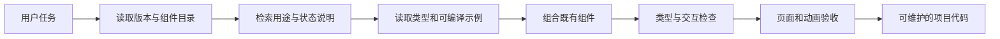

# aig-ui AI 复用与交互规范

本规范配合[实施方案](./implementation-plan.md)、[加载动效规范](./motion-system.md)和[交付计划](./delivery-plan.md)使用，定义首版面向代码智能体的资料契约，以及面向产品用户的 AI 交互契约。

## 1. AI 复用的完整路径



AI 先确定使用中的 aig-ui 版本，再查找具体组件与页面组合。源码、说明和示例必须对应这个版本，避免模型依据旧文档猜测属性。组件目录索引适合检索，完整源码只在需要理解行为时加载。

用户描述“像参考页那样加载后反向解构”时，AI 应定位 LoadingSequence，读取任务状态和退出示例，复用既有编排。用户描述“保存按钮转圈”时，AI 应选择 Button loading。组件推荐来自适用场景与边界，不能只按名称关键词匹配。

## 2. 真源与生成关系

| 内容 | 人工维护真源 | 自动产物 |
| --- | --- | --- |
| API | TypeScript Props、公共导出与 JSDoc | 属性摘要、类型引用、API Markdown |
| 使用含义 | 组件就近的 `README.md` 及简短结构化头信息 | 用途、关键词、使用条件、关联组件 |
| 示例 | 真正参与类型检查的 TSX 示例与 Story | 文档代码块、AI 示例文件、示例 ID |
| 视觉 Token | DTCG 源 JSON | CSS、动效 JS 常量、Token 文档 |
| 分发 | Registry 源描述与 block 源码 | `registry.json`、单项 JSON 与文件内容 |
| 版本 | 包版本、Git 提交与构建流程 | 所有机器资料的 libraryVersion、sourceCommit |

采用现有类型/文档提取能力，例如 Storybook 使用的 react-docgen-typescript，在构建时读取 Props；确需直接使用时将其声明为开发依赖。生成器负责组装和校验，保持一份真实类型来源。

不支持自动展开的泛型或复杂类型应输出准确类型名、声明文件与说明；任何人工补充的必填项和默认值，都要用类型示例或断言检查。普通继承的 DOM 属性通过类型引用提供，索引突出 aig-ui 特有参数，避免把上百个 HTML 属性重复灌入每个条目。

## 3. 机器可读资料

### 3.1 发布文件

| 文件 | 内容与大小方向 | 使用方 |
| --- | --- | --- |
| `manifest.json` | 版本、组件 ID、用途短句、导入路径、说明和示例链接；首版目标小于 100KB 未压缩 | IDE、智能体和静态搜索 |
| `components/<id>.json` | 单组件参数摘要、状态、部件、约束和引用 | 已选定组件的精读 |
| `api/<id>.json`、`source/<module>.tsx` | 完整参数提取结果与版本对应源码快照 | 需要核对契约和实现时精读 |
| `components/<id>.md` | 人类与模型共用的组件说明 | 无专用工具时直接读取 |
| `examples/<id>.tsx` | 从实际示例源复制，保持可编译 | AI 组合与修改参考 |
| `llms.txt` | 库定位、版本、安装、视觉规则和文档链接 | 辅助发现入口 |
| `llms-full.txt` | 按发布版本聚合说明，按需下载 | 无法多次检索的离线场景 |
| `r/registry.json`、`r/<name>.json` | Registry 目录与源码安装项 | shadcn CLI 与兼容工具 |

静态站点和 npm 包中的资料使用相同生成来源。npm 包包含核心索引、按组件拆分资料和示例；静态站点另外提供完整聚合文档与 Registry。资料目录均带版本，用户可以下载后离线读取。

`llms.txt` 是文档发现约定，兼容程度要以所使用的工具实际验证。Markdown 与真实示例保留为基本接入方式。[llms.txt 提案](https://llmstxt.org/)

### 3.2 单组件条目示例

以下为拟定的 aig-ui 自有元数据格式，`schemaVersion` 管理结构版本。示例采用未来 1.0.0 版本表示目标形态，当前并无对应发布包。真实构建填入实际版本、提交与文件校验值。

```json
{
  "schemaVersion": "1.0",
  "library": "aig-ui",
  "libraryVersion": "1.0.0",
  "id": "loading-sequence",
  "name": "LoadingSequence",
  "summary": "以 SVG 绘制、反向撤回和解构完成加载到内容的交接。",
  "keywords": ["加载", "初始化", "SVG", "反向绘制", "解构", "loading"],
  "importPath": "aig-ui/motion",
  "styleImports": ["aig-ui/styles.css", "aig-ui/motion/styles.css"],
  "useWhen": ["应用首次启动", "工作空间初始化", "有明确结束信号的资料处理"],
  "alternatives": [
    { "id": "spinner", "when": "局部高频等待" },
    { "id": "button", "when": "按钮提交中的短反馈" }
  ],
  "propsRef": "api/loading-sequence.json",
  "sourceRef": "source/motion/loading-sequence.tsx",
  "examples": ["loading-brand-startup", "loading-early-ready", "loading-retry"],
  "states": ["loading", "ready", "error"],
  "accessibility": ["状态文本播报", "遵循减少动画偏好", "交接时恢复内容可交互性"],
  "status": "stable"
}
```

状态 `stable` 仅在该版本验收通过后生成，早期条目标注 `experimental` 或 `beta`。sourceRef 相对于资料根目录解析，构建时同时生成该位置的源码快照；每个引用都经过存在性检查。内部代码的业务函数、个人路径和调试信息不进入发布目录。

该格式与 shadcn Registry schema 分开。前者解决“如何选用和理解组件”，后者解决“安装哪些源码和依赖”。对外安装 JSON 保持官方 schema 兼容，避免兼容工具因自定义字段变化失效。

## 4. 分发和 Registry

### 4.1 v1.0 分发策略

基础组件、LoadingMark/LoadingSequence 和 AI 组件通过 npm 使用；5 个页面组合通过 Registry 安装源码。页面组合 import 已发布的 aig-ui，全部公共组件来自同一实现。

用户需要修改布局和业务行为时编辑本地配方，需要调整统一视觉时覆盖语义 Token。深度修改基础组件可从版本对应源码开展受控派生；首版提供源码与说明，不承诺自动合并这些修改。

Registry 可用静态 JSON 交付，shadcn 现有 CLI 与 MCP 可以处理兼容的 Registry；这构成首版接入途径。[Registry](https://ui.shadcn.com/docs/registry)、[MCP](https://ui.shadcn.com/docs/mcp)

### 4.2 Registry 源描述示例

```json
{
  "$schema": "https://ui.shadcn.com/schema/registry-item.json",
  "name": "access-state-page",
  "type": "registry:block",
  "title": "访问状态页",
  "description": "使用 aig-ui 展示资源不存在、登录过期或访问受限，可组合完整加载序列。",
  "dependencies": ["aig-ui@1.0.0"],
  "files": [
    {
      "path": "registry/blocks/access-state-page/access-state-page.tsx",
      "type": "registry:component"
    }
  ]
}
```

这是构建前的源描述，构建后填充实际文件 content；依赖中的示例版本由发布脚本替换为真实同批版本。若 block 有 CSS 或局部 helper，必须列出全部文件，并在消费项目验证 import 路径与目标路径。[Registry item schema](https://ui.shadcn.com/docs/registry/registry-item-json)

首版 block 优先使用导出组件和 Token，减少独立 CSS。确需 CSS 时一起交付，并在配方入口明确导入；基础和 motion 样式要求在宿主全局样式入口导入。Registry 安装说明使用明确提示帮助接入方完成入口配置。

### 4.3 安装契约与兼容边界

首次联调使用本地静态 Registry，先校验 JSON，再用锁定版本的 shadcn CLI 安装 `access-state-page` 到干净消费项目。正式命名空间采用 `@aig-ui`，仅表示用户项目中的配置别名，官方 Registry 目录收录需要单独申请，方案不假设已经获得。

部署后，以真实 Registry 地址配置 `components.json` 的 registries 映射，并安装具体 block。正式域名和 CLI 版本尚未确定，当前文档保留参数式命令，S4 将其替换成经验证的命令和完整配置：

```text
pnpm dlx shadcn@<已验证版本> add <实际 Registry 单项 URL>
```

上述是命令模板。npm 直接安装路径始终独立可用，接入方无需为了使用基础组件引入 Tailwind。Registry 配方以普通 CSS 和 aig-ui 为目标，在已有 shadcn/Tailwind 项目及无 Tailwind 的 React 项目中分别验证；如锁定 CLI 对初始化配置有额外要求，提供经过验证的最小配置或配方源码下载流程，不强制引入无关样式系统。

首版提供可版本化的 `/v/<version>/r/<name>.json` 路径，以及便于试用的当前版本入口。工程和 AI 评估使用固定版本入口；相同版本下文件内容保持不可变。

### 4.4 升级与源码归属

| 分发内容 | 更新方式 | 修改归属 |
| --- | --- | --- |
| npm 基础、动效与 AI 组件 | 包管理器升级，查看变更说明和迁移例子 | aig-ui 维护者 |
| Registry block | 对比原版本和新版本源码，审阅后合并 | 安装后由业务项目维护 |
| 业务主题覆盖 | 验证新版本 Token 兼容性 | 业务项目 |
| AI 文档缓存 | 按 libraryVersion 与文件校验值更新 | 工具或业务项目 |

每次安装记录原始 Registry URL、aig-ui 版本、block 文件与校验值，记录在业务项目的文档或已有依赖记录中。首次升级采用 Git diff 审阅即可；确有大量自动升级需求时再增加专用工具。已有源码发生本地修改时保留修改，显示清晰差异。

## 5. 提供给代码智能体的使用规则

后续仓库根 `AGENTS.md` 与发布资料中的使用指南提供以下简短约定，具体组件行为仍以版本对应文档和类型为准。

1. 先识别任务、现有技术栈和已安装的 aig-ui 版本。
2. 从目录查询组件用途和页面配方，读取必要的类型、状态与示例。
3. 优先组合已有组件；样式使用语义 Token，布局使用宿主已有模式。
4. 加载仪式感使用 LoadingSequence；短反馈使用 Spinner、Progress 或 Button loading。
5. 业务应用提供数据、权限和回调；UI 组件表达可见状态。
6. 表单、加载、错误、空数据、禁用与键盘行为按实际场景补齐。
7. 使用可编译示例；交付前完成对应类型、交互与视觉检查。
8. 真正新增公共能力时同步源码、测试、示例、用途说明和变更记录。

首版只维护一份框架中立的使用规则正文。IDE 特有配置作为薄入口引用它，减少多份规则内容逐渐分叉。

## 6. AI 产品交互契约

### 6.1 状态由任务事实驱动

| 状态 | 用户文案方向 | 可执行动作 |
| --- | --- | --- |
| `idle` | 输入任务或查看建议 | 输入、发送 |
| `queued` | 任务已排队 | 取消、继续编辑下一条草稿 |
| `running` | 正在处理，可显示已知步骤 | 停止或取消 |
| `streaming` | 正在生成，保留已收到内容 | 停止、复制已生成内容 |
| `awaiting-confirmation` | 结果已就绪，说明拟执行动作和影响 | 编辑、确认、拒绝 |
| `succeeded` | 任务已完成 | 查看来源、复制、继续处理 |
| `failed` | 说明失败范围和可恢复路径 | 重试、修改输入、保留草稿 |
| `cancelled` | 任务已取消，已生成内容仍可查看 | 重新提交、继续编辑 |

该表为公共展示词汇，具体组件只接收与自身相关的状态子集。TaskStatus 展示任务状态；Message 展示消息状态；Confirmation 展示提交中的确认状态。组件以受控数据为主，不重复实现业务任务调度器。

网络流或工具回调包含稳定的 requestId/taskId。用户停止后迟到的片段由应用层过滤；新任务使用新标识。若要抽出适配工具，只在已存在多个调用方且边界稳定时进行。

### 6.2 流式消息与阅读体验

Message 接收累积文本或已经整理好的内容片段。未完成 Markdown 采用容错显示，内容在流式更新中保持稳定；默认正文文本与 GFM 是首版范围，代码高亮按需加载。

Conversation 仅在用户处于底部附近时跟随新消息；用户向上阅读时保持位置并显示“有新内容”。新增消息保留稳定 key，历史消息加载后恢复阅读位置。大消息列表先分页，只有实测出现渲染瓶颈时引入虚拟滚动。

辅助技术按阶段与节流后的消息摘要播报，避免逐 token 打断。PromptInput 识别中文输入法合成状态，Enter 发送与 Shift+Enter 换行的示例经过浏览器验证，草稿在失败和取消后保留。

### 6.3 来源、工具与确认

SourceList 显示真实传入的来源标题、地址和可选片段，缺少来源时采用普通文本结果。对不完整来源不补造地址。工具展示包括用途、可公开的输入摘要、当前状态、输出与错误；所谓过程说明仅指业务事件和可公开步骤摘要。

Confirmation 提交前显示目标、变更摘要及影响，用户确认后才触发宿主回调。组件内提交按钮的禁用属于交互保护；服务端仍以权限、数据版本和幂等键决定能否执行。确认界面绑定具体 artifactId 与 revision，内容变化后重新确认，旧界面的确认不能应用新内容。

ArtifactPreview 首版支持纯文本和安全 Markdown 产物，以版本切换、编辑、应用和取消形成闭环。差异比较可先采用前后两个文本视图；有实际长文差异审阅需求后引入专用 diff 组件。

### 6.4 安全边界

| 输入或动作 | 首版规则 |
| --- | --- |
| 模型文本 | 作为不可信内容处理，默认不执行 HTML、脚本或表达式 |
| Markdown | 关闭原始 HTML；链接协议采用允许列表；远程图片默认由宿主显式启用 |
| 工具结果 | 长度限制、折叠展示、敏感值脱敏由调用方执行，组件保留结构化摘要入口 |
| 应用结果 | 用户确认后调用业务回调；服务端验证权限、版本和幂等 |
| 模型服务 | SDK 和密钥在业务应用内，组件库展示层不持有凭据 |
| 源码预览 | 展示文本即可；运行任意生成代码属于后续隔离沙箱能力 |
| Registry | 固定可信来源、锁定依赖、预览差异、校验相对文件路径和发布清单 |

以上边界与 AI 生成界面的实际输入和动作直接相关，作为实现要求纳入组件示例与测试。

## 7. AI 复用效果评估

先维护 12 个固定任务，每项提供目标、允许组件、预期交互和可执行检查。任务覆盖：品牌启动序列、提前就绪、失败重试、访问状态、保存表单、筛选为空、详情抽屉、消息流、阅读位置、来源展示、产物审核、窄屏长文本。

| 指标 | v1.0 初始门槛 | 记录方法 |
| --- | --- | --- |
| 首次类型检查通过 | 至少 11/12 | 固定模型版本、提示、依赖和文档版本；保存生成结果与编译输出 |
| 一轮修正后完成 | 12/12 | 最多一次基于失败日志的修正，记录人工介入 |
| 组件选用准确 | 至少 11/12 | 按预定义组件与行为规则评分 |
| 关键风险 | 0 个未处理问题 | 可访问名称、复制失败、重复提交、失效确认、内容执行等强制检查 |
| 加载动画复用 | 使用 LoadingSequence 与任务状态接口 | 检查是否重复创建时间轴和描边实现 |
| 原有资产复用 | 每个任务按预设清单检查 | 记录新增重复组件、硬编码视觉值与未声明依赖 |

在一个选定代码智能体上完成全量任务，另一个工具执行代表性任务以验证资料可移植性。模型服务不可用时先运行确定性的消费项目和文档验证，AI 实际评估项保留待验收状态。命中率门槛是本项目目标，不是模型效果保证。

## 8. 运行时生成式 UI 的后续路线

只有产品明确需要“模型运行时选择组件并返回界面结构”时，才进入这一步。可借鉴 json-render 的受限组件目录、参数校验和动作映射，优先采用已验证的现成能力。[json-render](https://json-render.dev/)

1. 从已稳定的 Card、Text、Badge、Progress 等少量组件建立允许目录。
2. 为这部分可序列化输入提供独立 schema；函数、ReactNode、任意 CSS 与脚本不直接进入模型协议。
3. 先完整校验结构，再渲染；设置节点数量、深度、文本长度和允许 URL 的边界。
4. 动作 ID 映射到宿主已注册函数，参数再次校验；敏感写入沿用权限与确认流程。
5. 缺失组件、非法参数、版本不匹配时显示明确的安全降级状态。
6. 如果支持流式结构，先完成可验证的节点再呈现，保留失败恢复和已确认内容。

这是一项独立的 v1.1+ 可选功能，普通 AI 编码复用与 v1.0 组件库均可先完整交付。
