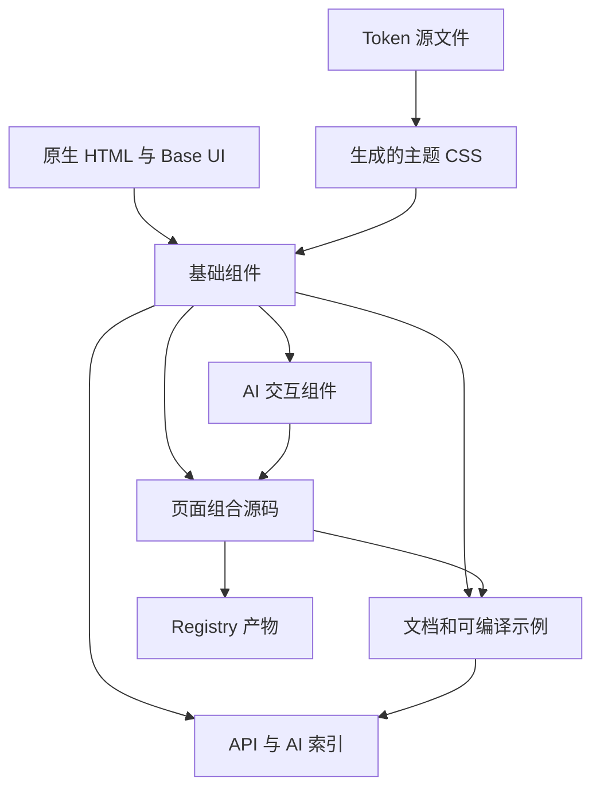

# aig-ui UI 组件库实施方案

版本：方案 1.0。编写日期：2026-09-11。状态：可进入实施的建设基线。

本方案以 [design.md](../reference/design.md) 和 [404.html](../reference/404.html) 为本地依据，结合组件源码分发、可组合 API、设计 Token、机器可读文档及受约束的 AI 界面生成实践制定。技术选型、组件 API、数值预算和排期属于本项目建议基线；通过各阶段验收后，才能记为已实现能力。

完整方案由本文、[加载动画与动效系统](./motion-system.md)、[AI 复用与交互规范](./ai-reuse-spec.md)及[实施排期与验收](./delivery-plan.md)组成。本文确定建设内容，配套文档确定标志性动效、AI 使用契约与交付证据。

用户补充的重点已纳入方案：**404.html 中的加载动画是首要参考资产，尤其是 SVG 绘制、多元素动效配合、加载完成后的反向绘制与解构效果。** 首个切片先完成该动效的可控组件化，再扩展页面与通用组件。

## 1. 项目结论

建设一个以 React 为首个实现平台的 UI 组件库，产品名称固定为 **aig-ui**。以可访问的基础交互和统一视觉为底座，提供基础组件、常用页面组合和 AI 产品交互组件；同时交付可检索的组件说明、可编译的示例、结构化索引和兼容 shadcn 的 Registry。

首版采用 **npm 分发基础组件，Registry 分发可编辑的页面组合源码**。两条路径引用同一份基础实现。开发者获得稳定升级路径，AI 获得真实 API、源码和组合范例。组件源码保存在仓库并随版本发布，基础组件按文件复制的安装模式在出现实际深度定制需求后扩展。

首版采用 React 19、TypeScript strict、CSS 自定义属性、普通 CSS 和 Base UI。构建基础组件使用 TypeScript 编译及少量 Node 文件生成脚本；文档和示例使用 Storybook + Vite。首版集中维护一个可发布包，通过子路径划分基础组件、AI 组件、样式和元数据。

### 1.1 首版成果

| 成果 | 完成定义 |
| --- | --- |
| 视觉系统 | 暖白主题、完整语义色、尺寸与动效 Token、实色材质降级、密度规则 |
| 标志性加载动画 | LoadingMark 与 LoadingSequence 完整覆盖描边生成、协同等待、反向擦除、解构退场和内容接续 |
| 通用组件 | 本文第 7 节列出的 G0、G1 组件全部通过对应行为验收 |
| AI 交互组件 | 输入、消息、来源、任务状态、工具结果、结果预览与用户确认完整闭环 |
| 页面组合 | 访问状态页、设置表单、筛选列表、AI 助手、生成结果审核共 5 个示例 |
| AI 复用资料 | 版本化 Markdown、组件索引、可编译示例、Registry、简短使用规则 |
| 工程交付 | npm tarball、静态文档产物、Registry JSON、消费项目验收记录、变更说明 |

### 1.2 基线假设

| 项目 | 默认决策 | 需要改变路线的条件 |
| --- | --- | --- |
| 首批用户 | 构建智能产品、管理后台和工作台的 React 开发者与代码智能体 | 首个接入项目明确采用其他框架 |
| 框架范围 | React Web；验证 Vite CSR 与 Next.js 服务端渲染场景 | 有实际 Vue、Svelte 或原生移动端接入方 |
| 主题 | v1.0 保证浅色暖白、实色降级和高对比度环境可用 | 深色主题有已确认的产品需求，再加入独立验收范围 |
| 语言 | 文档和默认提示采用简体中文；API 使用英文标识 | 新增语言时提供消息字典与实际长文本验收 |
| 运行时 | UI 接收数据和回调，业务应用负责网络、鉴权和持久化 | 独立适配器存在两个以上真实调用方 |
| 包名与发布 | 产品名为 aig-ui；npm 名称先查可用性与账号归属 | 同名包已占用时采用实际持有的 scope，产品名保持 aig-ui |
| 浏览器 | 发布时的 Chrome、Edge、Firefox 当前及前一稳定主版本，Safari 当前及前一稳定主版本 | 客户要求更旧版本时增加兼容成本与测试矩阵 |

上述假设足以开始本地工程建设。发布账号、正式域名、许可证选择和实际试点接入方在首次对外发布前落实；其缺失不影响前期组件实现。

## 2. 参考文件分析

### 2.1 当前仓库事实

截至编写时，仓库仅包含两个参考文件，没有 `package.json`、组件源码、构建脚本和既有组件依赖；Git 尚无首个提交。方案按新建项目设计，工程命令和目录树均为目标结构。

已完整阅读两份文件，并在浏览器默认 1280 × 720 视口查看参考 HTML 的静态展示。该观察用于确认视觉方向；移动端、辅助技术、性能和全量交互验收属于后续实施任务。

### 2.2 从视觉原型提取可复用资产

| 参考内容 | 可继承的设计价值 | 组件化落点 |
| --- | --- | --- |
| 暖白径向背景与低饱和玫瑰色 | 安静、柔和、精密的品牌基调 | 语义色 Token、可选 AmbientBackground |
| `.panel` 半透明表面、内高光与扩散阴影 | 轻盈的材质层级 | Card、Panel、Dialog 的共享样式规则 |
| 标题、说明、请求信息和日志分区 | 主任务与辅助信息层级清晰 | PageHeader、Result、DescriptionList、ActivityLog |
| 线性 SVG、圆环与描边 | 精密状态提示语言 | Icon、Spinner、Progress 的可选几何外观 |
| 悬停复制、Toast、底部状态点 | 高频小操作和状态反馈 | CopyButton、Toast、StatusIndicator |
| `clamp()`、Grid、弹性日志区 | 可随容器调整的布局 | CSS Grid/Flex、Panel 内容滚动策略 |
| 减少动画媒体查询 | 兼顾用户系统偏好 | 全组件动效规则及减少动画测试 |

### 2.3 原型进入组件库前的调整

| 源码证据 | 当前含义或影响 | 实施决策 |
| --- | --- | --- |
| 文件名为 `404.html`，正文为 `ACCESS DENIED`、`SESSION EXPIRED` | 视觉示例混合资源不存在、登录过期和权限不足 | Result 接收明确业务状态；分别提供页面未找到、登录已过期、访问受限的配方，HTTP 状态由服务端或路由决定 |
| 第 25–29 行锁定页面滚动，多层容器裁切内容 | 小高度、缩放和长文本可能失去可达区域 | 普通页面允许纵向滚动；工作台通过明确的 Panel 内容区域滚动；以实际溢出用例验收 |
| 第 68、227、954–961 行固定等待约 2.4 秒后入场 | 视觉编排完整，入场时间与资源就绪状态尚未连接 | 保留绘制、反向绘制与解构编排；LoadingSequence 由真实 ready 信号驱动，品牌场景保留可配置的完整入场时段 |
| 第 849 行通过 `div` 点击复制 | 缺少原生按钮的键盘语义 | CopyButton 使用原生 button，支持 Enter、Space、焦点样式与失败反馈 |
| Toast 只有显示样式，没有状态播报语义 | 辅助技术可能错过结果 | 通过成熟 Toast 基础提供 live region、关闭及计时暂停行为 |
| 第 922 行起拼装固定日志，时间基于本次访问偏移 | 日志内容是模拟事件 | 演示明确标识模拟数据；ActivityLog 只显示调用方传入的真实或显式演示事件 |
| `formatClock()` 将本地时间固定标为 CST | 非中国时区可能产生误标 | 时间格式化交给调用方或 `Intl.DateTimeFormat`，显式传入 locale、timeZone |
| 第 1040 行只限制指针监听，第 1069 行仍启动 RAF | 减少动画时仍有持续帧回调 | 基础组件使用 CSS 动效；可选视差只在活动期间调度，响应系统偏好并释放监听和 RAF |
| 46px 背景模糊、大范围光晕、多层阴影 | GPU 合成与滚动成本需要测量 | 玻璃集中于少量容器，表格与正文区域默认实色，支持无模糊降级 |
| 全局 reset、body 样式和 Google Fonts 导入 | 接入方受到全局样式与外部网络影响 | 发布样式以 `aig-` 命名空间限定；reset 为显式可选；字体由宿主配置，默认系统字体 |
| `.grid`、`.scan` 和持续旋转 | 与 design.md 对明显网格、复杂扫描的克制要求存在张力 | 默认主题采用静态环境光；扫描、网格和视差仅作为可选实验演示 |

### 2.4 色彩证据与修正方向

以下为按 WCAG 相对亮度公式计算的纯色与白底对比度，未包含实际透明叠加、字体抗锯齿和背景光晕。因此它们是设计修正依据，不能替代渲染结果验收。

| 参考色 | 白底对比度 | 首版用途 |
| --- | --- | --- |
| 主文字 `#3a3234` | 12.46:1 | 继续作为主要文字候选 |
| 次文字 `#8b7f80` | 3.86:1 | 调深后用于小字号正文与说明 |
| 品牌玫瑰色 `#b98b90` | 2.93:1 | 装饰、柔和填充；主按钮与文字采用更深的功能色 |
| 错误 `#cf8b84` | 2.73:1 | 状态背景与装饰；配深色状态文字 |
| 成功 `#8bb3a1` | 2.32:1 | 状态背景与装饰；配深色状态文字 |
| 警告 `#d9a982` | 2.11:1 | 状态背景与装饰；配深色状态文字 |

将 design.md 的“低对比度”落实到背景和装饰层，信息文字与可识别的交互边界采用明确对比度。普通文字以 4.5:1、大字号文字以 3:1、适用的非文本控件信息以 3:1 为验收基线；阈值、例外和判定依据遵循 [WCAG 2.2](https://www.w3.org/WAI/WCAG22/quickref/)。

## 3. AI 可复用设计原则

“AI 可复用”在本项目中包含两个独立目标：代码智能体能够准确选用既有组件；应用能够向用户呈现可理解、可编辑、可确认的 AI 输出。

| 原则 | aig-ui 的具体落地 | 验证方式 |
| --- | --- | --- |
| 源码可理解 | 小型组件模块、真实类型、简体中文 JSDoc、版本对应的源码链接 | 从文档定位实现，示例通过编译 |
| API 可预测 | 统一命名、默认值、状态、可控值和回调约定 | 类型测试与跨组件用法检查 |
| 组合优先 | Button、Field、Dialog 等构建页面，业务配方保持可编辑 | 同一基础组件用于至少两个不同场景 |
| 资料可检索 | 索引提供用途、关键词、输入输出、示例和依赖 | 固定 AI 任务集验证检索与首次生成成功率 |
| 分发可验证 | npm 版本、Registry、API 索引与示例来自同一提交 | 空项目安装与版本一致性检查 |
| 输出可控 | AI 状态清晰、保留草稿、明确来源、显式应用结果 | 中断、重试、拒绝、过期结果与确认用例 |
| 渐进建设 | 先完成基础组件与文档，再接入可选生成式运行时 | 独立阶段交付，不依赖模型服务才能运行组件库 |

此处借鉴 shadcn 的源码开放、组合接口和代码分发理念，以及 AI Elements 的可组合 AI 交互实践；具体架构和范围由 aig-ui 的维护成本与目标决定。[shadcn 设计原则](https://ui.shadcn.com/docs)、[AI Elements](https://elements.ai-sdk.dev/)

## 4. 技术路线

### 4.1 选型与采用理由

| 层次 | 首版选择 | 采用理由与边界 |
| --- | --- | --- |
| 语言与视图 | React 19、TypeScript strict | 类型可直接提供给开发者和智能体；v1 首先支持一个框架 |
| 基础交互 | 原生 HTML + `@base-ui/react` | Button、Input、Table 保留原生语义；浮层、组合选择、菜单等复用成熟交互 |
| 样式 | 普通 CSS、CSS 自定义属性、`aig-` 类名前缀 | 可直接提取参考页视觉，接入方无需 Tailwind 或 CSS-in-JS 运行时 |
| Token 源文件 | DTCG 2025.10 格式的受限子集 | 保留 `$type`、`$value` 与别名，支持后续设计工具交换 |
| 包工程 | pnpm workspace，一个可发布包 | 文档与消费示例可以分开运行，避免多个基础包同步发版 |
| 包编译 | `tsc` 输出 ESM、声明与 sourcemap；Node 复制和生成静态资源 | 保留组件模块与 `use client` 指令；先不引入额外打包器 |
| 示例与文档 | Storybook React + Vite、MDX/Markdown | 共用演示与交互用例，静态发布，减少重复维护一个文档网站 |
| 验证 | Vitest、Testing Library、Playwright、axe | 类型与纯逻辑、DOM 交互、浏览器集成、自动可访问性各有职责 |
| 图标 | `lucide-react` 按图标引用 | 已有统一线性图标风格；仅品牌几何标记使用自有小 SVG |
| AI 文本 | AI 子路径使用 `react-markdown`，GFM 按需求配置 | 默认关闭原始 HTML；代码高亮与重型预览按需接入 |
| 分发发现 | npm、shadcn Registry、静态 Markdown 与 JSON | 使用已有工具检索和安装，首版无需自研 CLI 与 MCP 服务 |

Base UI 提供无样式且可组合的 React 交互组件，并有 Portal 等接入要求；本项目在其上实现 aig-ui 视觉与公共 API，仍需验证包装后的行为。[Base UI 介绍](https://base-ui.com/react/overview/about)、[接入与 Portal](https://base-ui.com/react/overview/quick-start)

### 4.2 依赖选择规则

依次选择仓库已有实现、原生 HTML/CSS、平台 API、已安装依赖，最后增加新依赖。复杂浮层的焦点管理属于成熟交互基础职责；复制文本使用 Clipboard API；格式化使用 Intl；布局使用 CSS Grid/Flex。

表单首版使用原生表单语义与 Field 组合。复杂数据列表由调用方传入排序、分页和选择状态。出现实际大表、多排序或列分组需求时，单独评估 TanStack Table；日期范围、富文本编辑、虚拟列表和图表同样按真实场景引入相应依赖。

组件库保持模型供应商中立。业务项目将模型 SDK 的状态转换为 aig-ui 的展示状态；SDK、API Key、数据库和网络重试策略属于业务应用。

### 4.3 版本与兼容策略

实施 S0 时锁定 React、TypeScript、Base UI、Storybook、Vite、Node 活跃 LTS 和 pnpm 的具体可用版本，生成 lockfile 并记录兼容矩阵。本文只给出 React 19 的目标主版本，其余工具以真实安装验证后的组合为准。仓库记录 `engines`、`packageManager` 与 Node 版本文件，CI 使用相同版本。

`react` 与 `react-dom` 使用 peerDependencies；图标和交互基础使用 dependencies，按实际模块引用。React 的 peer 范围只覆盖已验证的版本。首版提供 ESM；CommonJS、React 18、其他框架和旧浏览器在接入需求确认后新增兼容任务。

## 5. 视觉与设计 Token

### 5.1 三层 Token

1. 原始值层：色板、间距、圆角、字重、时长、阴影。
2. 语义层：页面背景、正文、交互边界、主操作、危险反馈等用途。
3. 组件层：仅在组件有独立调优需求时添加，例如按钮高度、Panel 内边距。

组件主要消费语义 Token。业务页面通过主题覆盖语义值，保持跨组件一致；组件内部状态优先复用同一套语义色。Token 以 `--aig-` 开头，避免和参考文件及宿主变量冲突。

DTCG 源格式采用颜色、尺寸、数字、字体、时长、阴影与引用等本项目实际使用的类型，构建时校验并生成 CSS。采用标准中的受限子集即可，生成器明确报告不支持的类型和循环引用，后续需要更多格式时再评估 Style Dictionary。[DTCG 2025.10 格式](https://www.designtokens.org/tr/2025.10/format/)

### 5.2 初始主题候选

以下值可用于 S1 首轮样张。只有通过实际表面叠加、焦点状态和可访问性验收后才冻结为发布 Token。

| 语义 Token | 浅色候选 | 用途 |
| --- | --- | --- |
| `--aig-color-bg` | `#fdfaf9` | 应用背景 |
| `--aig-color-surface` | `#ffffff` | 实色内容表面 |
| `--aig-color-surface-muted` | `#f6f1f1` | 次级区块与弱填充 |
| `--aig-color-text` | `#3a3234` | 标题、正文 |
| `--aig-color-text-muted` | `#706367` | 辅助信息，白底约 5.72:1 |
| `--aig-color-accent` | `#7d4e57` | 主按钮背景、品牌文字，白底约 6.78:1 |
| `--aig-color-accent-soft` | `#f3e7e9` | 品牌弱填充 |
| `--aig-color-border-subtle` | `#e6dcde` | 纯装饰分隔线 |
| `--aig-color-border-control` | `#8c7d81` | 需要独立识别的控件边界，白底约 3.91:1 |
| `--aig-color-focus` | `#7d4e57` | 焦点轮廓；同时检查相邻背景 |
| `--aig-color-danger` | `#a0443a` | 错误文字与危险操作，白底约 6.21:1 |
| `--aig-color-success` | `#3f765e` | 成功文字，白底约 5.30:1 |
| `--aig-color-warning` | `#8a5b24` | 警告文字，白底约 5.83:1 |

浅色成功、警告、错误背景分别与深色文字配对，状态同时提供图标或文字。禁用态保留内容可辨性，并遵循对应控件的真实禁用行为。

### 5.3 尺寸、字体与密度

| 维度 | 初始基线 |
| --- | --- |
| 间距 | 4、8、12、16、20、24、32、40、48、64px；特殊 2px 微调有明确用途 |
| 圆角 | 控件 8/12px，Card 20px，Panel/Dialog 24px，展示区可选 32px，胶囊使用 999px |
| 控件高度 | sm 32px、md 40px、lg 48px；触屏主操作优先 44px 以上有效目标区域 |
| 字体 | 正文系统无衬线字体；代码与标识使用系统等宽字体；由宿主选择自托管品牌字体 |
| 字号与行高 | 正文 14/20 或 16/24；说明 12/18；标题 20/28、24/32、32/40 |
| 字重与字距 | 正文 400，重点 500/600；中文正文默认正常字距，大字距仅用于短装饰标签 |
| 密度 | 默认舒适；compact 缩小列表行距和容器内边距，保持有效点击区域与可读字号 |
| 响应式 | 先依据容器和内容换行；页面配方以 640/960/1280px 为初始断点，实际验收后调整 |
| 层级 | 普通内容、粘性区域、浮层、模态框、Toast 分级；嵌套浮层由基础库与统一 Portal 处理 |

首版只抽象实际存在的尺寸。布局使用 `minmax(0, 1fr)`、`min-inline-size: 0`、逻辑边距和自然换行。长 ID 支持可读换行与完整复制；表格在自己的滚动容器内横向滚动。

### 5.4 材质、主题作用域与动效

| 能力 | 实施规则 |
| --- | --- |
| 实色表面 | 默认正文、表单、表格和高密度内容使用稳定的不透明背景 |
| 玻璃表面 | 主要容器按需启用，初始 blur 为 16–24px，最多两层明显玻璃叠加；46px 原型值留作对照 |
| 环境背景 | AmbientBackground 采用静态 CSS 光晕，独立装饰层，`aria-hidden`、无指针命中 |
| 降级 | `@supports` 检测模糊能力；提供显式实色材质设置；forced-colors 使用系统色并保留边界 |
| 主题作用域 | 默认暖白 Token 可直接使用；通过 `data-aig-theme`、`data-aig-density` 和 CSS 变量覆盖 |
| 多主题浮层 | AigProvider 仅管理主题/文案/方向/Portal 配置；浮层容器同步作用域属性及变量来源，验证两个嵌套主题同时打开浮层 |
| 即时反馈 | 按下、输入和焦点立即响应；装饰过渡初始 120–200ms |
| 区块转换 | 200–300ms；状态描边与装饰入场 300–1200ms，动作完成不等待装饰结束 |
| 减少动画 | 依据 `prefers-reduced-motion` 提供静态状态，同时停止 JS 循环与监听 |
| 无限动画 | 圆环与扫光用于活跃等待阶段；退场结束及时停用；确定进度显示真实数值，未知进度显示未定进度 |

加载动画为独立核心能力，完整的多元素时间轴、反向绘制和解构规范见[加载动画与动效系统](./motion-system.md)。上述一般控件时长不覆盖标志性加载序列的专用编排。

design.md 的 300–1200ms 用于区块与状态动画。高频控件反馈采用更短时长，是本方案为操作效率提出的具体化决策，在 S1 视觉评审中一并确认。

## 6. 组件 API 与行为契约

### 6.1 通用规则

| 方面 | 统一约定 |
| --- | --- |
| 命名 | React 组件使用 PascalCase，文件和 Registry ID 使用 kebab-case；每个概念只有一个主名称 |
| 标准属性 | 适当透传原生属性、`aria-*`、`data-*`、`className`、`style` 和 ref |
| 原生控件事件 | Input、Textarea 使用标准 `onChange(event)`；以准确 HTML 类型表达 |
| 组合控件值 | Select、Tabs 使用 `value`、`defaultValue`、`onValueChange(value)`；Checkbox/Switch 使用 checked 系列 |
| 开关状态 | Dialog、Drawer 使用 `open`、`defaultOpen`、`onOpenChange(open)`；受控值由调用方更新 |
| 默认动作 | Button 默认 `type="button"`；提交按钮显式使用 `type="submit"` |
| 默认值 | size 默认 md；Button variant 默认 primary；默认值在实现、类型说明和示例中保持一致 |
| 状态 | 按语义覆盖 default、hover、active、focus-visible、disabled、loading、invalid；静态组件仅覆盖适用项 |
| 复杂内容 | Dialog 等使用 Root/Trigger/Content/Title/Description/Actions 组合，基础能力保持一个来源 |
| 组合渲染 | 初期 Button 为原生按钮，Link 为原生链接；需要路由替换的部件沿 Base UI 的 render 机制，避免并存多套多态接口 |
| 稳定选择器 | 以 role、可访问名称验收；确需定位的组件提供 `data-aig-component`，内部结构类名不作为业务依赖 |

Modal 统一命名为 Dialog，Navigation 拆为 Navigation 与 Breadcrumb 等明确结构，Loading 拆为 Spinner、Skeleton、Progress。文档记录参考名称与实际导出名称的对应关系，AI 索引包含别名关键词。

### 6.2 代表性契约

以下为待实现的 API 草案，S1 验证后冻结。它用于明确责任与参数，并非当前仓库已有代码。

```tsx
import type { ComponentPropsWithRef } from 'react';

/** 执行动作的按钮，保留原生按钮属性与键盘行为。 */
export interface ButtonProps extends ComponentPropsWithRef<'button'> {
  /** 按钮的视觉层级，默认 primary。 */
  variant?: 'primary' | 'secondary' | 'outline' | 'ghost' | 'danger';
  /** 控件尺寸，默认 md。 */
  size?: 'sm' | 'md' | 'lg';
  /** 显示进行中状态并阻止重复激活。 */
  loading?: boolean;
}

/** 由调用方提供复制内容，组件负责复制结果反馈。 */
export interface CopyButtonProps extends Omit<ButtonProps, 'children' | 'onClick'> {
  value: string;
  label?: string;
  onCopySuccess?: () => void;
  onCopyError?: (error: Error) => void;
}

/** 显示真实业务状态，文字用于表达颜色之外的状态含义。 */
export interface StatusIndicatorProps {
  tone: 'neutral' | 'info' | 'success' | 'warning' | 'danger';
  label: string;
  busy?: boolean;
}
```

IconButton 在上述 Button 契约上要求可访问名称。loading 时保留按钮尺寸与可访问名称，并设置 `aria-busy`；默认通过禁用行为阻止重复提交，业务应用同时负责请求幂等。CopyButton 调用 Clipboard API；失败后保留可选中的原文并展示“复制未完成，请手动复制”，成功回调仅在写入成功后触发。

Dialog 的 Title 为基本用法必需内容，Description 按场景配置。打开后移动焦点、限制模态区域内的 Tab 顺序、支持 Escape、关闭后恢复焦点；异步提交保留内容和错误提示。Drawer 复用相同交互基础，首版提供侧边抽屉，不引入手势拖拽物理效果。

Field 通过 label、description、error 建立输入关联；错误和帮助内容保留稳定 ID。表单失败后保留输入，定位首个错误；选择项由稳定值标识。组件不自行读取业务权限或发送请求。

### 6.3 服务端渲染与浏览器 API

模块顶层保持纯定义。Clipboard、matchMedia、ResizeObserver、计时器与事件监听在用户动作或 effect 内运行，并提供释放逻辑。ID 使用 React 的稳定 ID 能力，避免随机数引起水合差异。

交互组件入口保留 `use client`，纯展示组件保持可在服务器使用。根入口兼容常规应用，服务端示例优先使用明确子路径。类型编译、复制脚本和发布产物检查均要确认指令保留；通过实际 Next.js 消费项目检查边界与水合日志。[React 客户端边界说明](https://react.dev/reference/rsc/use-client)

## 7. 组件与页面组合范围

G0 为首个可复用切片，G1 为 v1.0 完整通用范围，A1 为 v1.0 AI 交互范围。以下按组件族计数，复合组件的子部件不重复计数。每个组件族的适用状态、示例和行为验收随组件一起交付。

另设优先于 G0 的 M0 动效核心：`LoadingMark` 负责 SVG 元素绘制与等待，`LoadingSequence` 负责加载层、文字/进度配合、反向绘制、解构和内容接续。完整契约见[动效规范](./motion-system.md)。它们与 Spinner、Progress 职责明确，作为首版公共组件交付。

### 7.1 G0：视觉和参考页闭环，共 17 个组件族

| 组件 | 核心能力 | 关键验收 |
| --- | --- | --- |
| Button | 五种操作层级、三种尺寸、loading | 键盘、提交语义、重复激活、焦点可见 |
| IconButton | 图标动作 | 可访问名称、有效点击区域 |
| Link | 原生导航语义与文字链接样式 | 键盘、外链属性、长文本 |
| Text | 正文、说明和语义色 | 换行、缩放与对比度 |
| Heading | 标题级别与视觉尺寸分离 | 正确标题层级 |
| Icon | 图标尺寸、视觉重量、装饰语义 | 图标名称或 aria-hidden |
| Card | 简单内容组和表面 | 内容自然伸展、材质降级 |
| Panel | Header/Body/Footer 与可选内部滚动 | 小高度、滚动边界、底部操作可达 |
| Badge | 分类标签 | 长标签与文字色 |
| StatusIndicator | 业务状态与忙碌指示 | 文字状态、减少动画 |
| Spinner | 未定进度等待 | 可访问名称、停止后卸载 |
| Progress | 已知或未知进度 | 数值边界、ARIA、真实进度 |
| EmptyState | 无内容与引导操作 | 首次使用和筛选为空的不同文案 |
| Result | 成功、错误、资源不存在、权限相关结果 | 清晰说明与恢复操作 |
| DescriptionList | 标签和值的信息列表 | `dl/dt/dd` 语义、长 ID、多列降级 |
| CopyButton | 复制与结果反馈 | 成功、拒绝、API 不可用 |
| Toast | 短时结果消息 | 状态播报、关闭、悬停与焦点暂停 |

### 7.2 G1：表单、导航与数据，共 23 个组件族

| 分组 | 组件 | 范围与关键验收 |
| --- | --- | --- |
| 原生输入 | Input、Textarea | label 关联、错误、禁用、自动填充、中文输入法 |
| 表单结构 | Field | 帮助、错误、必填、稳定 ID；与原生 form 配合 |
| 选择控件 | Checkbox、RadioGroup、Switch | 受控/非受控、键盘与真实表单值 |
| 下拉选择 | Select、Combobox | 单选、检索、空结果；异步选项状态由调用方传入 |
| 浮层 | Dialog、Drawer、Popover、Tooltip、DropdownMenu | 焦点、关闭、越界定位、嵌套浮层、主题继承 |
| 导航 | Tabs、Breadcrumb、Navigation、Pagination | 选中语义、方向键、当前页、路由链接插槽 |
| 数据 | Table | 原生表格子部件、caption、空态组合、排序按钮与可控选中行示例 |
| 反馈 | Alert、Skeleton | 区域错误与占位；保留尺寸、减少动画 |
| 信息组织 | Separator、Accordion、PageHeader | 分隔语义、展开键盘行为、标题与操作响应式排列 |

Table 首版保留表格语义。排序、筛选与分页通过页面组合及回调连接业务状态；虚拟滚动、列拖拽、树表和单元格编辑作为后续独立能力。Select 与 Combobox 首版单选；多选通过已确认场景另列任务。

### 7.3 A1：AI 交互，共 8 个组件族

| 组件 | 首版能力 | 责任边界 |
| --- | --- | --- |
| PromptInput | 输入、发送、停止入口、草稿保留 | 调用方传入状态和回调；附件与语音按后续需求扩展 |
| Message | 用户/助手消息、文本或安全 Markdown、操作区 | 消息状态由调用方提供 |
| Conversation | 消息容器、阅读位置保持、回到底部 | 历史加载由调用方负责 |
| SourceList | 来源标题、地址、片段、可选来源时间 | 来源真实性由业务数据保证 |
| TaskStatus | 等待、执行、待确认、完成、失败、取消等状态 | 显示可公开的步骤摘要 |
| ToolResult | 工具用途、输入摘要、状态、结果和错误 | 敏感字段由调用方脱敏 |
| ArtifactPreview | 生成文本/Markdown 与版本预览、编辑/应用入口 | 应用动作交给宿主，首版预览文本类产物 |
| Confirmation | 明确目标、影响、确认、拒绝和提交状态 | 服务端继续负责权限、幂等与实际执行 |

详细状态和模型边界见 [AI 交互规范](./ai-reuse-spec.md#6-ai-产品交互契约)。

### 7.4 可编辑页面组合，共 5 个

| Registry ID | 组成与场景 | 完成条件 |
| --- | --- | --- |
| `access-state-page` | PageHeader、Result、DescriptionList、CopyButton、StatusIndicator；可选 AmbientBackground/ActivityLog | 分别展示未找到、过期、受限；操作链接由宿主传入；参考视觉可辨认 |
| `settings-form` | Field、输入选择、Tabs、Button、Toast | 校验、异步保存失败、草稿保留、离开提醒示例 |
| `filterable-list` | PageHeader、筛选表单、Table、Pagination、Drawer | 加载、空数据、筛选为空、错误、详情和受控分页 |
| `ai-assistant` | PromptInput、Conversation、Message、SourceList、TaskStatus | 模拟流式输入、停止、错误重试、阅读位置保持 |
| `artifact-review` | ArtifactPreview、ToolResult、Confirmation、Dialog | 预览、编辑、取消、确认、执行失败和版本冲突 |

AmbientBackground、ActivityLog 是本阶段配方中的局部可复用部件，待第二个真实场景验证后提升为公共 API。FilterBar 是字段组合方式，DataTable 是 Table 的页面配方，避免同一职责同时出现多个基础组件。

## 8. 工程架构与目录

```text
aig-ui/
├─ reference/                         # 原始参考
├─ docs/                              # 实施与治理文档
├─ packages/
│  └─ aig-ui/
│     ├─ src/
│     │  ├─ components/button/         # 组件、样式、示例、测试、用途说明
│     │  ├─ components/dialog/
│     │  ├─ motion/                    # LoadingMark、LoadingSequence 与固定编排
│     │  ├─ ai/                        # AI 组件，独立导出
│     │  ├─ theme/                     # Provider 与主题配置
│     │  ├─ tokens/                    # DTCG 源文件
│     │  └─ index.ts                   # 基础公共出口
│     ├─ dist/                         # 生成的 JS、类型、CSS、AI 索引
│     └─ package.json
├─ registry/
│  ├─ blocks/                         # 5 个页面组合的真实源码
│  └─ registry.json                   # 分发描述源文件
├─ apps/
│  └─ docs/                          # Storybook、MDX、构建出的静态资源
├─ examples/
│  ├─ vite-consumer/                   # 从 tarball 安装的消费验收项目
│  └─ next-consumer/                   # SSR、客户端边界和水合验收
├─ scripts/                           # Token、索引、Registry、发布产物检查
├─ .github/workflows/                 # 质量链与发布流程
├─ pnpm-workspace.yaml
├─ pnpm-lock.yaml
└─ package.json
```

目录按首次使用时创建。Button 单组件目录包含实现、独立 CSS、可编译示例和测试；用途说明与组件就近维护。规模增长时按真实依赖拆分，避免先建立多层空接口。

### 8.1 依赖方向



基础组件保持独立于业务配方；AI 组件可以复用基础组件；文档和索引由源码与示例生成。页面配方接收数据与业务回调，和组件包的依赖方向保持一致。

### 8.2 样式与发布出口

计划出口为 `aig-ui`、`aig-ui/button` 等基础子路径、`aig-ui/motion`、`aig-ui/ai`、`aig-ui/ai/message` 等 AI 子路径，以及 `aig-ui/styles.css`、`aig-ui/motion/styles.css`、`aig-ui/ai/styles.css`、`aig-ui/tokens.css`、`aig-ui/manifest.json`。

基础样式含默认 Token，motion 和 AI 样式仅包含各自附加样式；`tokens.css` 用于只消费主题的项目。组件样式在源码中分开，构建时按依赖顺序生成静态 CSS。首版采用显式样式导入，接入应用在自己的全局样式入口导入一次；每组件 CSS 子路径在实际包体需求出现后增加。

发布包设置 ESM 与显式 `exports`、`types`、`files`；CSS 在 `sideEffects` 中保留，JS 模块保持无顶层副作用。TypeScript 保留模块目录及相对 `.js` 导入，消费项目检验浏览器构建与 Node 导入；构建产物记录 sourcemap 与声明映射。包体积验收同时测基础组件入口和 AI 子路径，防止普通按钮引入 Markdown 依赖。

### 8.3 计划中的使用方式

以下片段仅在对应版本构建和安装完成后可运行。若 npm 名称使用 scope，生成文档时统一替换实际包名。

```tsx
import { Button, Card, Heading, Text } from 'aig-ui';
import 'aig-ui/styles.css';

export function WelcomeCard() {
  return (
    <Card>
      <Heading level={2}>开始创建</Heading>
      <Text>使用统一组件构建界面。</Text>
      <Button type="button">新建项目</Button>
    </Card>
  );
}
```

交互示例必须补齐真实或显式模拟的回调。上述静态片段用于展示基础组合；文档中可点击示例会提供具体动作与结果，避免操作控件只有外观。

## 9. 文档与 AI 资料体系

每个公开组件交付：用途、安装与导入、最小示例、完整状态示例、属性默认值、组合结构、键盘说明、主题 Token、适用边界和版本信息。文档直接引用会编译的示例源文件，演示、文本和类型表随代码变更同步更新。

机器侧提供轻量目录、按组件拆分的 Markdown、`manifest.json` 和 Registry。TypeScript Props 是 API 真源；手写说明补充用途和业务选择依据。生成器输出模型易读的参数摘要，遇到无法准确展开的类型时保留类型引用与源码位置。

接入方可以直接读取本地文件完成开发，也可以通过兼容工具检索 Registry。`llms.txt` 是辅助发现入口，其本身不保证任何模型自动读取；组件准确率由实际任务评估确认。[llms.txt 提案](https://llmstxt.org/)

文件契约、示例数据、Registry 安装与升级流程见 [AI 复用规范](./ai-reuse-spec.md)。

## 10. 首个垂直切片

先完成 LoadingMark、LoadingSequence 和专用动效样张，复现参考动画的 SVG 绘制、圆环/文字/进度配合、反向擦除与解构。提供真实就绪信号和可控演示信号两种调用示例，验证提前就绪、长时等待、中途失败和减少动画。

随后以访问状态页验证设计系统，完成 Button、Card/Panel、Result、DescriptionList、CopyButton、Toast、StatusIndicator 等直接依赖，再提供三个明确业务状态配方。

页面保留暖白、精密线性图标和柔和材质；正文与日志提高可读性。页面就绪后由 LoadingSequence 完成反向绘制、解构与内容接续；普通局部操作使用 Spinner 或 Progress。请求 ID 由调用方传入，复制有真实反馈；详情来自明确数据，模拟日志在演示中标识。小高度和缩放条件下所有内容与操作可达。

完成后将这些基础组件用于设置表单的局部示例，验证它们已经具备跨场景用途。只有纯展示页有效时，不进入批量组件扩展；先解决 API、主题、内容布局与可访问性问题。

## 11. 实施与变更管理

实施顺序为 S0 工程与契约、S1 加载动效与参考页闭环、S2 通用组件、S3 AI 交互、S4 AI 分发、S5 试点与发布。详细任务、依赖、责任、预算、质量脚本、完成定义和回退方式见 [实施排期与验收](./delivery-plan.md)。

公开 API、主题或分发策略发生变化时，同步修改类型、实现、示例、机器索引与迁移说明。单个组件完成适用检查后独立提交；公共基础变动优先验证调用它的组件和页面组合。

首版完成的标志是消费项目可以安装、开发者与 AI 可以正确复用、用户可以完成实际操作，并拥有可回退的发布产物。组件数量与视觉展示只是其中一部分证据。

## 12. 参考资料与采用范围

公开资料于 2026-09-11 核对。下列内容仅作为各自说明的依据；aig-ui 的具体 API、目录、阶段和性能预算由本方案提出。

| 官方资料 | 采用范围 |
| --- | --- |
| [shadcn 设计原则](https://ui.shadcn.com/docs) | 源码可见、组件组合、统一接口与 AI 友好方向 |
| [shadcn Registry](https://ui.shadcn.com/docs/registry) | 静态 JSON 分发代码资产 |
| [Registry item schema](https://ui.shadcn.com/docs/registry/registry-item-json) | 项目项、文件、依赖与安装描述 |
| [Registry 示例](https://ui.shadcn.com/docs/registry/examples) | 自定义源码与样式资产的分发参考 |
| [shadcn MCP](https://ui.shadcn.com/docs/mcp) | 通过现有工具发现、检索和安装兼容 Registry |
| [Base UI](https://base-ui.com/react/overview/about) | 可组合无样式交互基础 |
| [Base UI 接入](https://base-ui.com/react/overview/quick-start) | 安装、Portal 与应用样式边界 |
| [Base UI Dialog](https://base-ui.com/react/components/dialog) | 复合弹窗交互及部件职责参考 |
| [DTCG 2025.10](https://www.designtokens.org/tr/2025.10/format/) | Token 数据交换格式；社区组规范，非 W3C Recommendation |
| [AI Elements](https://elements.ai-sdk.dev/) | 消息、输入、来源、工具结果与确认等 AI 交互组合 |
| [json-render](https://json-render.dev/) | 后续运行时受限组件目录与动作映射的设计参考 |
| [llms.txt](https://llmstxt.org/) | 面向模型的文档发现约定；按提案使用 |
| [WCAG 2.2](https://www.w3.org/WAI/WCAG22/quickref/) | 对比度、键盘、重排、焦点与状态消息验收 |
| [Storybook 可访问性测试](https://storybook.js.org/docs/writing-tests/accessibility-testing) | 将自动可访问性检查接入组件开发与持续集成 |
| [React 客户端边界](https://react.dev/reference/rsc/use-client) | 交互模块的服务端/客户端边界 |
| [SVG pathLength](https://developer.mozilla.org/en-US/docs/Web/SVG/Reference/Attribute/pathLength) | SVG 路径长度归一化 |
| [Web Animations API](https://developer.mozilla.org/en-US/docs/Web/API/Element/animate) | 原生动画创建与实例控制 |
| [Animation.finished](https://developer.mozilla.org/en-US/docs/Web/API/Animation/finished) | 有限动画的完成信号 |
