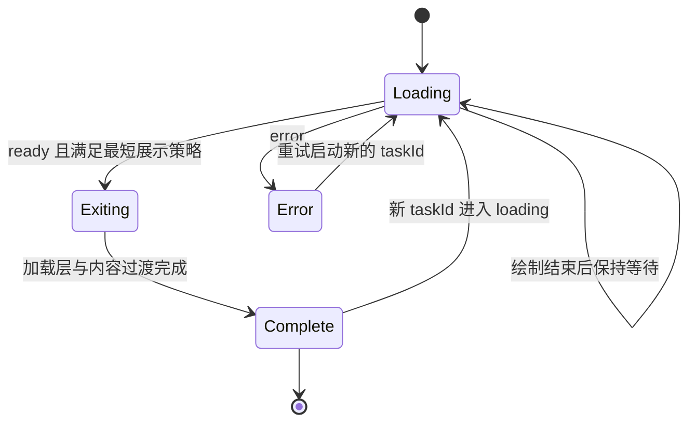

# aig-ui 加载动画与动效系统

2026-09-12 最新修订：装饰采用恒定亮度的轨道旋转与细线巡行；按钮族共用轮廓，品牌图形与颜色按[品牌自定义](./brand-customization.md)配置。原始参考参数保留作来源记录，当前视觉规则见[视觉风格定义](./design-language.md)。

版本：方案 2.0，修订日期：2026-09-12。本规范是[实施方案](./implementation-plan.md)的核心组成部分，以 [404.html](../reference/404.html) 加载动画为直接依据，落实《Detroit: Become Human》式仿生智能与精密科幻气质。核心叙事为：**元素逐步建立，多个层次协同运行，任务完成后撤回结构，表面解构并交接给内容。**

当前组件已有完整生命周期实现；本轮核验发现视觉参数、部分缓动、退场重叠与慢速控制偏差，见[核验记录](./design-review.md)。本版规定 R0–R2 的修正目标；方案中的新编排为待运行校准的候选，原型时间轴作为历史对照保留。

## 1. 需要保留的视觉特征

| 特征         | 用户看到的效果                     | 保留方式                                                |
| ------------ | ---------------------------------- | ------------------------------------------------------- |
| SVG 从无到有 | 三角轮廓被逐段画出，横线随后形成   | 使用 path/line 的 dasharray 与 dashoffset，保留错峰节奏 |
| 双圆环配合   | 外环缓慢顺时针，内弧反向旋转       | 保持不同方向、速度和透明度                              |
| 标签逐层出现 | 标题、次标题和进度条在不同时间浮现 | 使用独立延迟与轻微位移，组成一个序列                    |
| 等待阶段     | 结构完成后，环形运动与扫光保持活跃 | 绘制保持最终形态，等待信号来自实际任务                  |
| 反向绘制     | 轮廓和横线沿路径撤回               | 明确的退出阶段，保留线条撤回过程                        |
| 解构退出     | 加载层放大、变模糊、透明并消散     | 反向绘制与整体解构适度重叠                              |
| 内容接续     | 主内容从轻微缩小和偏下位置进入     | 与退出建立短暂交叠，避免空白和突然切换                  |

这套语言将成为 aig-ui 的标志性加载体验。优先用于应用启动、工作空间打开、资料解析、长任务阶段切换等具有明确开始与完成边界的场景；按钮提交、局部查询等高频操作使用短反馈组件。

## 2. 原始动画的元素分解

| 元素               | 源码参数                                                 | 职责                       |
| ------------------ | -------------------------------------------------------- | -------------------------- |
| 全屏 `.loader`     | 固定覆盖、暖白径向背景、列布局                           | 组织加载图形、文字与进度   |
| `.loader-mark`     | `viewBox="0 0 200 200"`；显示宽高约 88–118px             | SVG 绘制舞台               |
| 外环 `.ring-outer` | 中心 100/100，半径 92，线宽 0.9，dash `3 9`，透明度 0.30 | 细腻、缓慢的外围运动       |
| 内环 `.ring-inner` | 半径 84，线宽 1.1，dash `120 408`，透明度 0.55           | 与外环形成反向速度差       |
| 三角 `.tri`        | `M100 38 L164 148 L36 148 Z`，线宽 2.2                   | 主轮廓，从不可见绘制到完整 |
| 横线 `.bar`        | 从 60/112 到 140/112，线宽 2.2                           | 延迟建立内部结构           |
| `.loader-label`    | 两层文字、7px 间距、整体淡入上移                         | 显示主体身份和任务说明     |
| `.loader-bar`      | 1.5px 高，120–168px 宽，内部 38% 扫光                    | 提供未定进度的活跃感       |
| `.stage`           | scale 0.975、Y 14px，逐渐恢复                            | 主内容的接续入口           |

SVG 图形、描边宽度、透明度、相对位置和暖玫瑰色作为首轮还原基线。应用名称和说明由组件属性提供，不固定使用原型中的安全终端文案。

R1 直接恢复外环 0.9/0.30、内环 1.1/0.55 的线宽/透明度，以及 `#b98b90`。图形保持 `fill="none"`，品牌样张采用 `clamp(88px, 13vh, 118px)`；局部组件继续接受 size。比较时同时固定渲染尺寸，1280×720 原型约为 93.6px。

品牌光晕按原型 `drop-shadow(0 0 22px rgba(185,139,144,0.26))` 建立基准。原型身份标签 600 字重、6px 字距、6px 首行补偿，次标签 500 字重、4px 字距作为对照值。中文任务说明采用可读字号和自然字距，与短身份标签分层；不把原型 8.5–9.5px 说明直接用于必要业务文字。确认的文字和光晕样式进入组件公共样式或可分发配方。

## 3. 原始时间轴

以下单位为毫秒，以原始页面加载为 0。CSS 与 JavaScript 的定时均来自参考文件。

| 元素/过程     | 开始 |       持续 | 结束 | 属性与节奏                                   |
| ------------- | ---: | ---------: | ---: | -------------------------------------------- |
| 外环顺时针    |    0 | 每圈 14000 | 持续 | transform，linear                            |
| 内环逆时针    |    0 |  每圈 7000 | 持续 | transform，linear                            |
| 三角绘制      |  150 |       1150 | 1300 | dashoffset 392 → 0，曲线 `(0.45,0,0.2,1)`    |
| 标签淡入      |  550 |        850 | 1400 | opacity 0 → 1，Y 7px → 0                     |
| 进度轨道淡入  |  750 |        850 | 1600 | 与标签同类淡入                               |
| 横线绘制      |  950 |        650 | 1600 | dashoffset 84 → 0                            |
| 进度扫光      |    0 |  每轮 1700 | 持续 | left 从 -38% 移到 100%，早期被轨道透明度遮蔽 |
| 三角反向绘制  | 2400 |        980 | 3380 | dashoffset 0 → 392                           |
| 横线反向绘制  | 2400 |        720 | 3120 | dashoffset 0 → 84                            |
| 加载层解构    | 2400 |        800 | 3200 | opacity → 0，scale → 1.06，blur → 10px       |
| 主内容接续    | 2400 |       1150 | 3550 | scale 0.975 → 1，Y 14px → 0，opacity → 1     |
| 加载 DOM 移除 | 3400 |       即时 | 3400 | JavaScript 定时移除                          |

原型同时启动三角与横线擦除，但它们的结束时间不同，形成内部结构先撤回、外部轮廓后撤回的层次。整体解构与主内容进入从同一时刻开始，形成重叠交接。

原型有一处需要精修：加载层在 3200ms 已变为不可见，而三角擦除持续到 3380ms，最后约 180ms 的反向绘制可能被提前遮蔽。组件化时保留原始版本作为对照，再调整解构重叠，让反向绘制的尾段有足够的可见时间。

## 4. 建议的正式编排

### 4.1 保持入场，重新校准退出交接

入场采用原始 0–1600ms 的错峰节奏，等待时继续双环与扫光。收到真实就绪信号后，以 `exitStart` 为相对起点执行退出。

| 退出相对时间 | 行为                                           | 初始候选                                           |
| ------------ | ---------------------------------------------- | -------------------------------------------------- |
| 0ms          | 三角与横线从实际位置撤回，状态区域播报就绪     | 完整图形：三角 980ms、横线 720ms                   |
| 0–180ms      | 原加载标签与进度轨道独立淡出，标记继续清晰撤回 | 标签退场候选 180ms，尚未出现的元素保持隐藏         |
| 180–720ms    | 三角和横线反向绘制，主内容保持隐藏             | 装饰图形与文字采用独立动画层                       |
| 720ms        | 横线撤回结束，标记组与品牌表面开始解构         | 解构 800ms，scale 1→1.06、blur 0→10px、opacity 1→0 |
| 980ms        | 三角撤回结束，主内容开始建立                   | 内容 1150ms，scale 0.975→1、Y 14px→0、opacity 0→1  |
| 1520ms       | 完整表面消散结束                               | 擦除与消散均完成后释放遮挡及内容交互隔离           |
| 2130ms       | 主内容进入结束                                 | 汇合实际完成信号，触发一次 `onExited`              |

这套候选替代旧版“180ms 同时开始解构和内容进入、1330ms 完成”的取值。首先消除文字重影并保留可见的撤回，再在受控样张中校准重叠和总时长；待确认后统一写入 Token。表中时间对应完整绘制后退出，实际清理以 `Animation.finished` 为准。`onExited` 仍表示整个交接完成，内容在遮挡消失且可用时恢复交互。

透明 SVG、加载表面和主内容各自负责一层。Inline 透明留白场景采用上述分阶段显隐，主内容显现前原加载文字已经退出。品牌全屏场景的背景表面必须随同消散，Portal 外壳保留焦点职责；外壳上的不透明底色若未参与动画，会遮住内容并导致最终突然切换。两种 presentation 都进行实际播放验收。每个关键帧检查撤回线条的可见性，透明度数值只作诊断。

加载期间组件承载的内容区域设置 `aria-busy` 表达忙碌状态，同时通过 `inert` 隔离底层内容的焦点和交互；`aria-busy` 本身只提供语义。取消与恢复操作保留在可交互的加载层内。标签使用独立状态播报，SVG 作为装饰隐藏于辅助技术；完成后解除 inert，并根据场景恢复原焦点，路由标题聚焦由宿主决定。

### 4.2 任务状态与动画状态分开

任务状态由应用提供：`loading`、`ready`、`error`。动画状态由组件管理：`drawing`、`holding`、`erasing`、`dissolving`、`revealing`、`complete`。擦除、解构和内容进入允许按固定时间轴重叠，因此实现采用一个主阶段加相对时间，不强行把每个视觉子过程做成互斥状态。

核心阶段采用 `loading → exiting → complete`；加载中细分绘制/等待，退出中按时间轴叠加擦除、解构和内容进入。错误进入可恢复的错误展示，状态恢复或任务 ID 改变后开启新的序列。



同一 taskId 的重复 ready 信号保持幂等。组件退出时若收到新 taskId，取消旧序列并从新状态开始；旧动画 Promise 的完成回调通过当前序列标识过滤。卸载、重试、系统减少动画变化均清理旧动画与监听。

### 4.3 提前就绪与等待策略

| 场景                   | 推荐策略                                                                          |
| ---------------------- | --------------------------------------------------------------------------------- |
| 首次应用启动、品牌展示 | 调用方显式传入 `minimumVisibleMs=1600`，让完整绘制形成，再进入反向解构            |
| 一般任务加载           | `minimumVisibleMs=0`；提前 ready 时从当前实际描边位置撤回，按完成比例缩短擦除时间 |
| 首次渲染即 ready       | 直接显示内容，保持静止                                                            |
| 任务超过 1600ms        | 主标记停在绘制完成态，双环与进度扫光持续；文案显示真实阶段                        |
| 任务长时间等待         | 应用提供说明和取消入口；超时判定由真实任务策略产生                                |
| 加载错误               | 显示错误说明与重试/返回操作，保留任务上下文；采用明确的错误过渡                   |
| 减少动画开启           | 静态标记或短淡入，ready 后立即完成交接；最短品牌展示时间也随之解除                |

首次启动可以有完整的仪式感，普通页面切换由调用方决定是否使用这套较长序列。把完整动画作为可配置的明确能力，保留用户认可的视觉表现，同时让等待时长可控。

## 5. 最小组件结构

| 组件            | 公开职责                                         | 内部实现                                        |
| --------------- | ------------------------------------------------ | ----------------------------------------------- |
| LoadingMark     | SVG 标记、绘制、等待与擦除状态，可单独用于 Panel | 三角、横线、双环，共用固定 SVG 结构与时间 Token |
| LoadingSequence | 加载层、标签、进度、任务就绪、解构与内容接续     | 组合 LoadingMark；持有当前序列和清理逻辑        |
| Spinner         | 高频局部等待                                     | 简单圆环，无完整启动/解构编排                   |
| Progress        | 真实已知进度或未定进度                           | 与 LoadingSequence 配合时替代默认扫光显示       |

首版保持一套固定品牌标记、一套入场和退出编排。内部函数可以拆分为绘制和退出步骤，无需对外创建动画 DSL、轨道编辑器、时间轴引擎或可随意编排的动画插件系统。

### 5.1 沿用 LoadingSequence API

```tsx
import type { ReactNode } from 'react';

/** 以完整绘制、反向撤回和解构过渡连接任务加载与内容展示。 */
export interface LoadingSequenceProps {
  /** 同一次加载的稳定标识，重试和新任务使用新值。 */
  taskId: string;
  /** 真实任务状态，由调用方更新。 */
  status: 'loading' | 'ready' | 'error';
  /** 当前任务说明，支持在等待中更新。 */
  label: string;
  description?: string;
  /** 0 到 100；省略时显示未定进度。 */
  progress?: number;
  /** 默认 0；品牌启动配方显式采用 1600。 */
  minimumVisibleMs?: number;
  /** 默认 inline，由容器定义尺寸；fullscreen 覆盖页面。 */
  presentation?: 'inline' | 'fullscreen';
  /** 默认跟随系统，也可主动采用减少动画；系统偏好始终得到尊重。 */
  motion?: 'system' | 'reduced';
  /** 错误时提供说明与恢复操作。 */
  errorContent?: ReactNode;
  /** 可用于调用方提供取消操作。 */
  actions?: ReactNode;
  /** 整个交接完成后触发，同一序列触发一次。 */
  onExited?: () => void;
  children: ReactNode;
}
```

LoadingMark 沿用 `phase="drawing | holding | erasing | static"`、`size`、`motion`、`label` 和 `onErased`，完整签名以源码为准。序列默认跟随系统减少动画偏好，调用方可以进一步关闭动画，系统偏好具有优先级。时钟控制保持在演示内部，业务 API 延续任务状态接口。

children 首版表示已经准备好的内容节点或安全的占位结构；业务数据尚未就绪时由宿主提供占位，避免渲染会抛错的内容。Fullscreen 模式提供明确的 Portal 与焦点隔离，Inline 模式只影响所在区域。

progress 仅接收有限的 0–100 数值；非法值在开发环境提示并在显示上降级为未定进度，避免把无效数值呈现为完成。errorContent 缺省时显示明确的加载失败说明；重试和取消动作由调用方通过 actions 或 errorContent 提供。

## 6. 技术实现路径

### 6.1 SVG 绘制

三角和横线使用 `pathLength="1"`、`stroke-dasharray: 1`、`stroke-dashoffset: 1 → 0` 表达绘制比例。参考文件为三角写死 392、横线写死 84，而横线的实际坐标长度为 80；归一化后替换图形或调整尺寸仍有一致的绘制进度。[SVG pathLength](https://developer.mozilla.org/en-US/docs/Web/SVG/Reference/Attribute/pathLength)

SVG 使用 `currentColor`，从 Token 获得颜色。保持固定 viewBox 与中心旋转坐标；尺寸由外层缩放。调整描边是否采用 `vector-effect="non-scaling-stroke"` 时，同步比较 64、96、128px 下的视觉重量，以参考页 88–118px 区间为主要验收尺寸。

### 6.2 编排与取消

静态外观和环形循环采用 CSS。需要从当前进度反向撤回、协调完成与响应取消的序列采用原生 Web Animations API，使用实际起止值和 `Animation.finished` 汇合完成信号。对取消产生的 rejected Promise 做正常清理，组件卸载时取消自身创建的动画。[Element.animate](https://developer.mozilla.org/en-US/docs/Web/API/Element/animate)、[Animation.finished](https://developer.mozilla.org/en-US/docs/Web/API/Animation/finished)

同一元素的同一属性由单一机制管理：描边由 WAAPI 管理，环形旋转由 CSS 管理；解构作用于外层，内容进入作用于独立内容层。避免 CSS animation 与 WAAPI 同时竞争 dashoffset 或 transform。

提前 ready 时先读取并固定当前描边值，将归一化进度夹紧到 `[0,1]`，再取消入场动画和启动撤回。尚未出现的文字或进度条直接保持隐藏，正在淡入的元素从当前透明度退出。擦除时长按已绘制比例计算；以最长实际擦除时长 r 为基准，解构延迟取 `min(720ms,r)`，内容显现起点不早于 r 和旧标签淡出结束。仅为已出现的元素创建退出动画；所有轨道与完成条件使用实际创建的句柄。双环和扫光等无限循环在清理时取消，不加入完成等待。

移除加载层以擦除和解构完成为条件，使用浏览器动画完成信号，并处理减少动画、未创建动画和用户取消等直接完成路径。时钟仅用于计算最短展示剩余时间；不用多个相互独立的裸 setTimeout 决定组件生命周期。

重试前清理本次实例的句柄。React Strict Mode 的重复 effect 挂载与清理、后台切换、快速 ready、父组件卸载和两个实例并存均列为必要用例。

### 6.3 解构效果与性能

保留 scale 1 → 1.06、opacity 1 → 0、blur 0 → 10px 和完整多元素协作。图形组、标签组、加载表面及内容分别控制，解决相互遮挡和文字重影。采用现有 CSS、SVG、WAAPI 完成修正，优先维护固定编排。

进度扫光可用 transform 从左侧移出到右侧，替代逐帧修改 left；只在加载状态保持循环。will-change 仅在相应序列活动期间设置。完整退出、错误静止或组件不可见时停止等待动画；组件不维持全局 RAF。

完整效果保持开启，设备性能检测不减少轨道或替换解构。性能优化先处理重复渲染、布局失效和遗留监听，视觉等效后再采用。系统 `prefers-reduced-motion` 或显式 reduced 设置提供静态/短淡入表现，同时保留状态文本与正确完成时机。

## 7. 专用动效 Token

| Token/参数                     | 初值                             | 作用                           |
| ------------------------------ | -------------------------------- | ------------------------------ |
| `mark.draw.delay`              | 150ms                            | 三角开始                       |
| `mark.draw.duration`           | 1150ms                           | 三角建立                       |
| `mark.bar.delay`               | 950ms                            | 横线开始                       |
| `mark.bar.duration`            | 650ms                            | 横线建立                       |
| `label.enter.delay`            | 550ms                            | 标签开始                       |
| `progress.enter.delay`         | 750ms                            | 进度轨道开始                   |
| `support.enter.duration`       | 850ms                            | 标签/轨道浮现                  |
| `ring.outer.period`            | 14000ms                          | 外环顺时针周期                 |
| `ring.inner.period`            | 7000ms                           | 内环逆时针周期                 |
| `progress.sweep.period`        | 1700ms                           | 未定进度扫光周期               |
| `mark.erase.duration`          | 980ms                            | 三角撤回                       |
| `mark.bar.erase.duration`      | 720ms                            | 横线撤回                       |
| `sequence.label.exit.duration` | 180ms，待实现                    | 旧文字和轨道独立退出           |
| `sequence.dissolve.delay`      | 720ms，替换旧 180ms 候选         | 解构相对退出的延迟             |
| `sequence.dissolve.duration`   | 800ms                            | 解构时长                       |
| `sequence.reveal.delay`        | 980ms，待实现                    | 完整绘制场景的内容进入起点     |
| `sequence.reveal.duration`     | 1150ms                           | 内容接续                       |
| `ease.draw`                    | `cubic-bezier(0.45,0,0.2,1)`     | 三角与横线建立                 |
| `ease.erase`、`ease.dissolve`  | `cubic-bezier(0.4,0,0.2,1)`      | 撤回与解构；原型与绘制曲线不同 |
| `ease.enter`                   | `cubic-bezier(0.22,0.61,0.36,1)` | 标签、轨道和主内容建立         |
| `ease.sweep`                   | `cubic-bezier(0.5,0,0.5,1)`      | 未定进度扫光                   |
| `ease.orbit`                   | `linear`                         | 双环匀速运行                   |

表中为语义名称，与现有 `motionTiming` 的 kebab-case 键在 R1/R2 映射，新键同步更新 `source.json` 与生成脚本。时长、延迟、缓动、视觉重量和运动距离一起记录；WAAPI 与 CSS 使用共同来源，确认后再冻结。CSS 变量覆盖与 JavaScript 时间配置的支持范围在组件说明中明确列出。

## 8. 演示、AI 复用与验收

文档提供一个可操作的动效样张：播放、重放、暂停/继续、0.25/0.5/1 倍速、原版/精修版切换、提前就绪、持续等待、失败、重试、减少动画。调试控制只存在于演示页，业务组件暴露任务状态与必要设置。

R0 先校准演示工具。重放后创建的所有 CSS/WAAPI 动画都登记到本次演示实例，继承同一倍率与暂停状态；延迟创建的有限轨道同样生效。自动 ready 使用演示经过时间，暂停时一并暂停；原版 iframe 使用同一控制器驱动其本地演示适配层，包括原型定时退出和 DOM 移除。原始文件保持可独立播放，适配代码只属于演示与测试。真实任务另设正常时钟用例，避免用慢速工具推断真实生命周期。

品牌科幻表达检查建立顺序、双环相位和速度差、标记视觉主次、标签呼应与撤回层次。常规控件的细线激活、状态弧线和内容出现复用相关 Token，完整构建/解构在品牌任务中展示。

| 验收类别   | 必须取得的证据                                                                                           |
| ---------- | -------------------------------------------------------------------------------------------------------- |
| 视觉还原   | 原型与组件在同尺寸下的录屏或连续帧，覆盖三角、横线、双环、文字、进度条                                   |
| 关键帧     | 入场 0/150/550/950/1300/1600ms；新退出候选 0/180/450/720/980/1520/2130ms，保留旧 1330ms 供缺陷对照       |
| 完成感     | 明确可感知的反向绘制，旧文字退出后新文字进入，加载表面连续消散；Inline/Fullscreen 各自无重影、闪白和残留 |
| 工具可靠性 | 每条轨道倍率一致，暂停冻结动画与自动 ready，原版 iframe 与当前组件同尺寸同时间点                         |
| 复用外观   | 普通组件导入、Story、预览和独立安装包共享文字、光晕及材料样式                                            |
| 稳定性     | ready 为 0/200/1000/2400/10000ms；重复 ready、切换 taskId、卸载、错误重试                                |
| 生命周期   | 每次 onExited 恰好一次；旧任务完成信号不影响新任务；卸载后无遗留动画和事件                               |
| 可访问性   | 状态播报、底层内容隔离、减少动画、焦点交接、200% 缩放、强制颜色                                          |
| 性能       | 固定设备、浏览器和尺寸下记录完整效果的长任务、丢帧和清理情况；优化前后比较相同画面                       |

普通控件可采用静态快照，本动效使用真实时间播放与受控时间轴用例。受控帧对比用户确认的图形与交接基准，真实播放检查完成、取消和节奏。当前保存截图、透明背景断言或某时刻 opacity 大于阈值都不能单独判定视觉正确；更新相关旧断言时补上它们实际要保护的可见结果。

AI 元数据中将其用途标为“应用初始化、工作空间加载、资料处理阶段交接”，列出 `LoadingSequence` 与普通 Spinner 的选择依据、完整退出示例和减少动画约束。AI 生成页面时复用该组件及 Token，直接传入真实任务状态即可获得统一编排。

## 9. 实施优先级

按 R0 对照时钟、R1 图形与缓动、R2 完整退出推进；R3 将加载交接到具有相同科幻语言的真实表面。每个切片提交源码、样张、适用检查和进度，验收同时检查**SVG 元素变化、多元素协同、反向解构、仿生智能气质和跨场景一致性**。

## 静止与禁用呼吸补充（2026-09-12）

用户确认静止态和禁用态都保留呼吸。公共样式对按钮边线、字段线色、选择内核和容器刻线添加慢周期运动，默认周期分别为 4800ms 与 7200ms，真源位于 `tokens/source.json`。文字、布局和禁用语义保持稳定。输入的聚焦与错误线色优先于环境呼吸，系统减少动态效果设置停止装饰循环。预览页的呼吸开关仅控制环境动效；LoadingSequence 的任务、暂停、倍率和退出仍由专用演示控件管理。

## 自主运动补充（2026-09-12）

用户确认：呼吸不应是缩放脉动，静止元素应自行运动（例如圆缓慢旋转）。呼吸由"线色明暗"升级为"线、节点与光的自主运动"，与呼吸并存：

| 运动     | 机制                                                                                                                     | 周期 Token                                                            | 使用                                                                                        |
| -------- | ------------------------------------------------------------------------------------------------------------------------ | --------------------------------------------------------------------- | ------------------------------------------------------------------------------------------- |
| 轨道巡行 | `aig-ambient-orbit` 旋转带缺口圆环，`rotate` 属性连同平移组合                                                            | outer 14000ms / inner 7000ms；忙碌状态 2.4s                           | 单选与开关的选中轨道、状态点外环、Spinner 外圈（反向）                                      |
| 巡航光点 | `@property` 注册 `--aig-glint-x/y` 百分比变量，`aig-glint-x/y` 关键帧驱动背景层位置：4% 时间入场、38% 时间行驶、其后驻留 | `--aig-motion-glint-period` 6400ms（新增，真源 `tokens/source.json`） | 输入基线、文本域页边线、按钮底线、表头底线、浮层顶边、对话框中轴、面板侧轨、AI 底线与状态轨 |
| 节点自转 | `aig-node-spin` 从 45° 转到 405°，菱形节点持续旋转一圈                                                                   | outer/inner 周期                                                      | 页头、字段标签、徽章、分页、导航、警告、复选勾选、任务末步                                  |
| 对角明灭 | 卡片左上与右下短弧以 `--aig-motion-rest-period` 半周期相位差交替呼吸                                                     | rest 7200ms                                                           | Card                                                                                        |

约束：交互中（悬停、聚焦、错误、按下、加载）停止环境运动，仅保留任务性动画（扫描、轨道加速）；`prefers-reduced-motion` 下全部停止且形状完整（光点停在画面之外，不留残影）；强制颜色下装饰全部移除。巡航光点动画只作用于背景层与已注册变量，不触碰布局属性。

## 按钮交互补充（2026-09-13）

[参考文章](https://zhuanlan.zhihu.com/p/572806533)将三角闪切用于按钮与衬底的动态入场。当前按钮以四块共边的实心三角拼成矩形衬底，再收回到稳定轮廓。SVG 按按钮宽高适配，文字和图标始终位于上层。

| 状态           | 运动                             | 参数                                                                |
| -------------- | -------------------------------- | ------------------------------------------------------------------- |
| 入场           | 随机抽取 1～2 块，各硬切闪现一次     | 每块随机 240–360ms，延迟 0–120ms；单次闪现，`steps(1, end)`，总时长最多 480ms |
| 静止           | 基线光带驶过后驻留               | `--aig-motion-glint-period` 6400ms                                  |
| 悬停与键盘聚焦 | 鼠标移入重播切片；边框扩展并扫描基线       | 扩展 1px；`--aig-motion-scan-duration` 460ms                        |
| 按压           | 外框内收，松开回位               | 90ms 内收，300ms 回位                                               |
| 加载           | 专用图标与基线扫描，入场切片隐藏 | `--aig-motion-sweep-period` 1700ms                                  |
| 选中与展开     | 左侧选择标记常亮，底线加厚       | 跟随实际状态                                                        |
| 禁用           | 静态轮廓，入场切片隐藏           | 保留名称与尺寸                                                      |
| 复制结果       | 结果色沿基线扫描一次，对勾描画   | 520ms                                                               |

首次入场和每次鼠标移入均随机抽取 1～2 块切片并生成出现时刻，其余切片保持隐藏，每块选中的切片只闪现一次，结束时完全透明。持续悬停保持收回，离开后重新移入从头播放。按压、普通重渲染与加载切换保留当前时间轴，重新挂载时重新入场。减少动态效果直接展示稳定形态；预览环境暂停隐藏切片并让有限时间轴完成，恢复时维持已完成状态。闪切只作用于低对比衬底，文字和外框保持可读。
