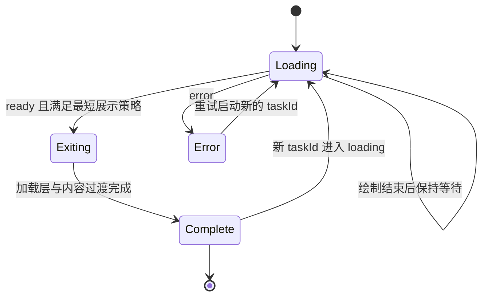

# aig-ui 加载动画与动效系统

本规范是 [实施方案](./implementation-plan.md)的核心组成部分，优先实现用户明确认可的 [404.html](../reference/404.html) 加载动画。目标是保留它的视觉叙事：**元素逐步建立，多个层次协同等待，任务完成后反向绘制，整体解构并交接给内容。**

现阶段已依据完整 HTML/CSS/JavaScript 解析时间轴，并观察参考页完成后的浏览器画面。本文列出的逐帧验收、慢速回放和性能数据仍为实施任务，尚未形成测量结论。

## 1. 需要保留的视觉特征

| 特征 | 用户看到的效果 | 保留方式 |
| --- | --- | --- |
| SVG 从无到有 | 三角轮廓被逐段画出，横线随后形成 | 使用 path/line 的 dasharray 与 dashoffset，保留错峰节奏 |
| 双圆环配合 | 外环缓慢顺时针，内弧反向旋转 | 保持不同方向、速度和透明度 |
| 标签逐层出现 | 标题、次标题和进度条在不同时间浮现 | 使用独立延迟与轻微位移，组成一个序列 |
| 等待阶段 | 结构完成后，环形运动与扫光保持活跃 | 绘制保持最终形态，等待信号来自实际任务 |
| 反向绘制 | 轮廓和横线沿路径撤回 | 明确的退出阶段，保留线条撤回过程 |
| 解构退出 | 加载层放大、变模糊、透明并消散 | 反向绘制与整体解构适度重叠 |
| 内容接续 | 主内容从轻微缩小和偏下位置进入 | 与退出建立短暂交叠，避免空白和突然切换 |

这套语言将成为 aig-ui 的标志性加载体验。优先用于应用启动、工作空间打开、资料解析、长任务阶段切换等具有明确开始与完成边界的场景；按钮提交、局部查询等高频操作使用短反馈组件。

## 2. 原始动画的元素分解

| 元素 | 源码参数 | 职责 |
| --- | --- | --- |
| 全屏 `.loader` | 固定覆盖、暖白径向背景、列布局 | 组织加载图形、文字与进度 |
| `.loader-mark` | `viewBox="0 0 200 200"`；显示宽高约 88–118px | SVG 绘制舞台 |
| 外环 `.ring-outer` | 中心 100/100，半径 92，线宽 0.9，dash `3 9`，透明度 0.30 | 细腻、缓慢的外围运动 |
| 内环 `.ring-inner` | 半径 84，线宽 1.1，dash `120 408`，透明度 0.55 | 与外环形成反向速度差 |
| 三角 `.tri` | `M100 38 L164 148 L36 148 Z`，线宽 2.2 | 主轮廓，从不可见绘制到完整 |
| 横线 `.bar` | 从 60/112 到 140/112，线宽 2.2 | 延迟建立内部结构 |
| `.loader-label` | 两层文字、7px 间距、整体淡入上移 | 显示主体身份和任务说明 |
| `.loader-bar` | 1.5px 高，120–168px 宽，内部 38% 扫光 | 提供未定进度的活跃感 |
| `.stage` | scale 0.975、Y 14px，逐渐恢复 | 主内容的接续入口 |

SVG 图形、描边宽度、透明度、相对位置和暖玫瑰色作为首轮还原基线。应用名称和说明由组件属性提供，不固定使用原型中的安全终端文案。

## 3. 原始时间轴

以下单位为毫秒，以原始页面加载为 0。CSS 与 JavaScript 的定时均来自参考文件。

| 元素/过程 | 开始 | 持续 | 结束 | 属性与节奏 |
| --- | ---: | ---: | ---: | --- |
| 外环顺时针 | 0 | 每圈 14000 | 持续 | transform，linear |
| 内环逆时针 | 0 | 每圈 7000 | 持续 | transform，linear |
| 三角绘制 | 150 | 1150 | 1300 | dashoffset 392 → 0，曲线 `(0.45,0,0.2,1)` |
| 标签淡入 | 550 | 850 | 1400 | opacity 0 → 1，Y 7px → 0 |
| 进度轨道淡入 | 750 | 850 | 1600 | 与标签同类淡入 |
| 横线绘制 | 950 | 650 | 1600 | dashoffset 84 → 0 |
| 进度扫光 | 0 | 每轮 1700 | 持续 | left 从 -38% 移到 100%，早期被轨道透明度遮蔽 |
| 三角反向绘制 | 2400 | 980 | 3380 | dashoffset 0 → 392 |
| 横线反向绘制 | 2400 | 720 | 3120 | dashoffset 0 → 84 |
| 加载层解构 | 2400 | 800 | 3200 | opacity → 0，scale → 1.06，blur → 10px |
| 主内容接续 | 2400 | 1150 | 3550 | scale 0.975 → 1，Y 14px → 0，opacity → 1 |
| 加载 DOM 移除 | 3400 | 即时 | 3400 | JavaScript 定时移除 |

原型同时启动三角与横线擦除，但它们的结束时间不同，形成内部结构先撤回、外部轮廓后撤回的层次。整体解构与主内容进入从同一时刻开始，形成重叠交接。

原型有一处需要精修：加载层在 3200ms 已变为不可见，而三角擦除持续到 3380ms，最后约 180ms 的反向绘制可能被提前遮蔽。组件化时保留原始版本作为对照，再调整解构重叠，让反向绘制的尾段有足够的可见时间。

## 4. 建议的正式编排

### 4.1 保持入场，还原退出

入场采用原始 0–1600ms 的错峰节奏，等待时继续双环与扫光。收到真实就绪信号后，以 `exitStart` 为相对起点执行退出。

| 退出相对时间 | 行为 | 初始候选 |
| --- | --- | --- |
| 0ms | 三角与横线开始撤回，任务标签更新为就绪状态 | 三角 980ms，横线 720ms |
| 0–180ms | 保留清晰加载图形，让用户感知反向绘制已经开始 | 加载层基本保持原始形态 |
| 180ms | 加载层开始解构，主内容开始接续 | 解构 800ms，内容进入 1150ms |
| 720ms | 横线完成撤回 | 内部结构消失 |
| 980ms | 三角撤回与加载层消散结束 | 清理 SVG 等待循环和遮罩 |
| 1330ms | 主内容进入结束 | 触发一次 `onExited`，状态回到静止 |

上述是拟定的第一轮精修版本，与原型同屏对照后确认。`onExited` 表示整个加载到内容的交接已结束；加载遮罩在 980ms 可先移除。内容在遮罩清理后恢复交互，不必等待最后 350ms 的装饰过渡。

加载期间组件承载的内容区域设置 `aria-busy` 表达忙碌状态，同时通过 `inert` 隔离底层内容的焦点和交互；`aria-busy` 本身只提供语义。取消与恢复操作保留在可交互的加载层内。标签使用独立状态播报，SVG 作为装饰隐藏于辅助技术；完成后解除 inert，并根据场景恢复原焦点，路由标题聚焦由宿主决定。

### 4.2 任务状态与动画状态分开

任务状态由应用提供：`loading`、`ready`、`error`。动画状态由组件管理：`drawing`、`holding`、`erasing`、`dissolving`、`revealing`、`complete`。擦除、解构和内容进入允许按固定时间轴重叠，因此实现采用一个主阶段加相对时间，不强行把每个视觉子过程做成互斥状态。

核心阶段采用 `loading → exiting → complete`；加载中细分绘制/等待，退出中按时间轴叠加擦除、解构和内容进入。错误进入可恢复的错误展示，状态恢复或任务 ID 改变后开启新的序列。



同一 taskId 的重复 ready 信号保持幂等。组件退出时若收到新 taskId，取消旧序列并从新状态开始；旧动画 Promise 的完成回调通过当前序列标识过滤。卸载、重试、系统减少动画变化均清理旧动画与监听。

### 4.3 提前就绪与等待策略

| 场景 | 推荐策略 |
| --- | --- |
| 首次应用启动、品牌展示 | 调用方显式传入 `minimumVisibleMs=1600`，让完整绘制形成，再进入反向解构 |
| 一般任务加载 | `minimumVisibleMs=0`；提前 ready 时从当前实际描边位置撤回，按完成比例缩短擦除时间 |
| 首次渲染即 ready | 直接显示内容，保持静止 |
| 任务超过 1600ms | 主标记停在绘制完成态，双环与进度扫光持续；文案显示真实阶段 |
| 任务长时间等待 | 应用提供说明和取消入口；超时判定由真实任务策略产生 |
| 加载错误 | 显示错误说明与重试/返回操作，保留任务上下文；采用明确的错误过渡 |
| 减少动画开启 | 静态标记或短淡入，ready 后立即完成交接；最短品牌展示时间也随之解除 |

首次启动可以有完整的仪式感，普通页面切换由调用方决定是否使用这套较长序列。把完整动画作为可配置的明确能力，保留用户认可的视觉表现，同时让等待时长可控。

## 5. 最小组件结构

| 组件 | 公开职责 | 内部实现 |
| --- | --- | --- |
| LoadingMark | SVG 标记、绘制、等待与擦除状态，可单独用于 Panel | 三角、横线、双环，共用固定 SVG 结构与时间 Token |
| LoadingSequence | 加载层、标签、进度、任务就绪、解构与内容接续 | 组合 LoadingMark；持有当前序列和清理逻辑 |
| Spinner | 高频局部等待 | 简单圆环，无完整启动/解构编排 |
| Progress | 真实已知进度或未定进度 | 与 LoadingSequence 配合时替代默认扫光显示 |

首版保持一套固定品牌标记、一套入场和退出编排。内部函数可以拆分为绘制和退出步骤，无需对外创建动画 DSL、轨道编辑器、时间轴引擎或可随意编排的动画插件系统。

### 5.1 LoadingSequence API 草案

```tsx
import type { ReactNode } from 'react';

/** 以完整绘制、反向撤回和解构过渡连接任务加载与内容展示。 */
export interface LoadingSequenceProps {
  /** 同一次加载的稳定标识，重试和新任务使用新值。 */
  taskId: string;
  /** 真实任务状态，由调用方更新。 */
  status: 'loading' | 'ready' | 'error';
  /** 当前任务说明，支持在等待中更新。 */
  label: string;
  description?: string;
  /** 0 到 100；省略时显示未定进度。 */
  progress?: number;
  /** 默认 0；品牌启动配方显式采用 1600。 */
  minimumVisibleMs?: number;
  /** 默认 inline，由容器定义尺寸；fullscreen 覆盖页面。 */
  presentation?: 'inline' | 'fullscreen';
  /** 默认跟随系统，也可主动采用减少动画；系统偏好始终得到尊重。 */
  motion?: 'system' | 'reduced';
  /** 错误时提供说明与恢复操作。 */
  errorContent?: ReactNode;
  /** 可用于调用方提供取消操作。 */
  actions?: ReactNode;
  /** 整个交接完成后触发，同一序列触发一次。 */
  onExited?: () => void;
  children: ReactNode;
}
```

LoadingMark 使用 `phase="drawing | holding | erasing | static"`、`size` 和可访问说明关联；具体类型在 S1 实现时冻结。序列默认跟随系统减少动画偏好，调用方可以进一步关闭动画，系统偏好具有优先级。

children 首版表示已经准备好的内容节点或安全的占位结构；业务数据尚未就绪时由宿主提供占位，避免渲染会抛错的内容。Fullscreen 模式提供明确的 Portal 与焦点隔离，Inline 模式只影响所在区域。

progress 仅接收有限的 0–100 数值；非法值在开发环境提示并在显示上降级为未定进度，避免把无效数值呈现为完成。errorContent 缺省时显示明确的加载失败说明；重试和取消动作由调用方通过 actions 或 errorContent 提供。

## 6. 技术实现路径

### 6.1 SVG 绘制

三角和横线使用 `pathLength="1"`、`stroke-dasharray: 1`、`stroke-dashoffset: 1 → 0` 表达绘制比例。参考文件为三角写死 392、横线写死 84，而横线的实际坐标长度为 80；归一化后替换图形或调整尺寸仍有一致的绘制进度。[SVG pathLength](https://developer.mozilla.org/en-US/docs/Web/SVG/Reference/Attribute/pathLength)

SVG 使用 `currentColor`，从 Token 获得颜色。保持固定 viewBox 与中心旋转坐标；尺寸由外层缩放。调整描边是否采用 `vector-effect="non-scaling-stroke"` 时，同步比较 64、96、128px 下的视觉重量，以参考页 88–118px 区间为主要验收尺寸。

### 6.2 编排与取消

静态外观和环形循环采用 CSS。需要从当前进度反向撤回、协调完成与响应取消的序列采用原生 Web Animations API，使用实际起止值和 `Animation.finished` 汇合完成信号。对取消产生的 rejected Promise 做正常清理，组件卸载时取消自身创建的动画。[Element.animate](https://developer.mozilla.org/en-US/docs/Web/API/Element/animate)、[Animation.finished](https://developer.mozilla.org/en-US/docs/Web/API/Animation/finished)

同一元素的同一属性由单一机制管理：描边由 WAAPI 管理，环形旋转由 CSS 管理；解构作用于外层，内容进入作用于独立内容层。避免 CSS animation 与 WAAPI 同时竞争 dashoffset 或 transform。

提前 ready 时先读取并固定当前描边值，再取消入场动画和启动撤回，避免取消后瞬间恢复初值。尚未出现的文字或进度条直接保持隐藏，正在淡入的元素从当前透明度退出。等待完成只汇合有限时长的擦除、解构与内容动画，双环和扫光等无限循环在清理时取消，不加入完成等待。

移除加载层以擦除和解构完成为条件，使用浏览器动画完成信号，并处理减少动画、未创建动画和用户取消等直接完成路径。时钟仅用于计算最短展示剩余时间；不用多个相互独立的裸 setTimeout 决定组件生命周期。

重试前清理本次实例的句柄。React Strict Mode 的重复 effect 挂载与清理、后台切换、快速 ready、父组件卸载和两个实例并存均列为必要用例。

### 6.3 解构效果与性能

保留 scale 1 → 1.06、opacity 1 → 0、blur 0 → 10px 的原始意图。第一版对照原型实现，随后测量全屏层滤镜成本。如果全屏 blur 超出预算，将模糊限制于图形和文字组，背景只淡出，保留相同的解构观感。

进度扫光可用 transform 从左侧移出到右侧，替代逐帧修改 left；只在加载状态保持循环。will-change 仅在相应序列活动期间设置。完整退出、错误静止或组件不可见时停止等待动画；组件不维持全局 RAF。

为 reduced-motion 与低性能设置提供静态/淡入降级，同时保留状态文本和正确完成时机。样式降级与业务任务状态相互独立。

## 7. 专用动效 Token

| Token/参数 | 初值 | 作用 |
| --- | --- | --- |
| `mark.draw.delay` | 150ms | 三角开始 |
| `mark.draw.duration` | 1150ms | 三角建立 |
| `mark.bar.delay` | 950ms | 横线开始 |
| `mark.bar.duration` | 650ms | 横线建立 |
| `label.enter.delay` | 550ms | 标签开始 |
| `progress.enter.delay` | 750ms | 进度轨道开始 |
| `support.enter.duration` | 850ms | 标签/轨道浮现 |
| `ring.outer.period` | 14000ms | 外环顺时针周期 |
| `ring.inner.period` | 7000ms | 内环逆时针周期 |
| `progress.sweep.period` | 1700ms | 未定进度扫光周期 |
| `mark.erase.duration` | 980ms | 三角撤回 |
| `mark.bar.erase.duration` | 720ms | 横线撤回 |
| `sequence.dissolve.delay` | 180ms | 解构相对退出的延迟 |
| `sequence.dissolve.duration` | 800ms | 解构时长 |
| `sequence.reveal.duration` | 1150ms | 内容接续 |

这些值集中于 Token 源文件，由构建同时生成 CSS 变量与只读 JavaScript 数值模块。WAAPI 和 CSS 共享来源；首版不承诺任意 CSS 变量覆盖都能改变 JavaScript 时间轴。主题层可调整材质和颜色，节奏变化由统一动效配置评审并生成。

## 8. 演示、AI 复用与验收

文档提供一个可操作的动效样张：播放、重放、暂停/继续、0.25/0.5/1 倍速、原版/精修版切换、提前就绪、持续等待、失败、重试、减少动画。调试控制只存在于演示页，业务组件暴露任务状态与必要设置。

| 验收类别 | 必须取得的证据 |
| --- | --- |
| 视觉还原 | 原型与组件在同尺寸下的录屏或连续帧，覆盖三角、横线、双环、文字、进度条 |
| 关键帧 | 入场 0/150/550/950/1300/1600ms，退出相对 0/180/720/980/1330ms |
| 完成感 | 明确可感知的反向绘制，解构与内容进入衔接自然；无突然闪白和线条残留 |
| 稳定性 | ready 为 0/200/1000/2400/10000ms；重复 ready、切换 taskId、卸载、错误重试 |
| 生命周期 | 每次 onExited 恰好一次；旧任务完成信号不影响新任务；卸载后无遗留动画和事件 |
| 可访问性 | 状态播报、底层内容隔离、减少动画、焦点交接、200% 缩放、强制颜色 |
| 性能 | 固定设备、浏览器和尺寸下录制轨迹，比较全屏 blur 与局部 blur；记录长任务和丢帧 |

普通视觉快照会关闭动画，本动效另设真实时间播放与受控时间轴用例。受控关键帧检查形态，真实播放检查事件完成、取消和实际节奏，两者分别记录。

AI 元数据中将其用途标为“应用初始化、工作空间加载、资料处理阶段交接”，列出 `LoadingSequence` 与普通 Spinner 的选择依据、完整退出示例和减少动画约束。AI 生成页面时复用该组件及 Token，直接传入真实任务状态即可获得统一编排。

## 9. 实施优先级

S1 的第一个交付物就是完整加载序列。先还原，再连接状态，再补边界，最后将其放入参考页面与另一种局部 Panel 场景中复用。首轮验收重点由用户认可的三项特征决定：**SVG 元素变化、多元素协同、反向绘制与解构交接**。
